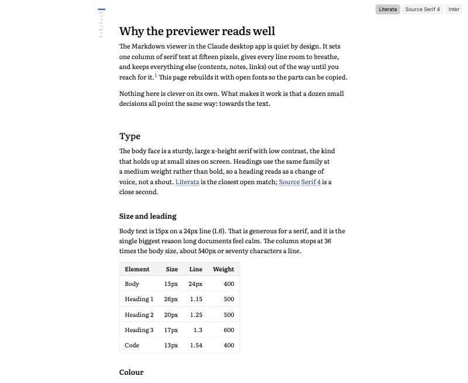
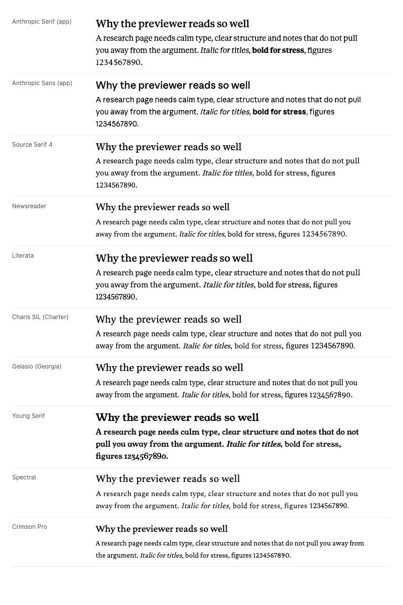
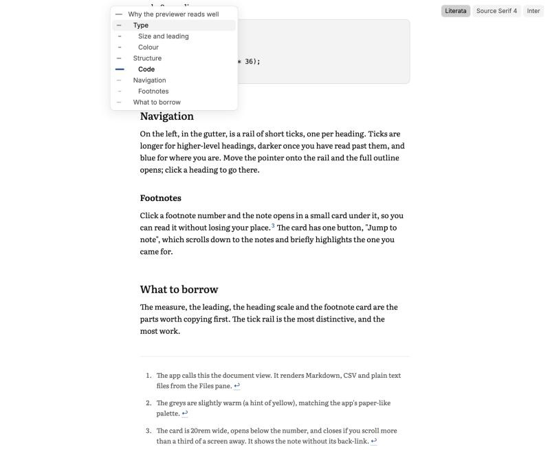
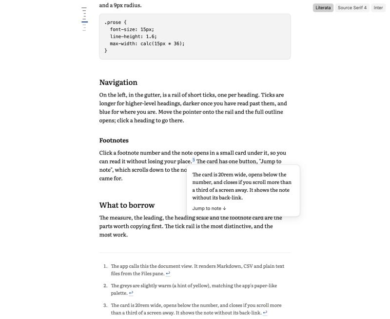

The Markdown previewer in the Claude desktop app (the Files pane in the Code tab) reads better than almost any docs or research site. This page works out why, from the app's own stylesheet, and rebuilds it with open fonts so we can borrow it for our [[Flowershow]] research and knowledge-base sites.

**Demo:** [claude-md-previewer/demo.html](claude-md-previewer/demo.html), a rebuild with open fonts. Switch the body font (Literata, Source Serif 4, Inter), hover the ticks on the left for the contents, click a footnote number.



## TL;DR

It isn't one clever trick. A dozen small choices all favour the text:

- a sturdy serif at **15px on a 24px line** (1.6)
- a **540px column** (36 × body size, about 70 characters)
- headings in the **same face at medium weight**, with space above that grows with rank
- **every border and fill is the ink colour at 5, 10 or 20% opacity**
- contents and footnotes that **stay out of sight until you reach for them**

## How I found this

Everything below comes from the app's own CSS, read in place from `/Applications/Claude.app/Contents/Resources/ion-dist.asar` (the Code tab UI). The previewer is the `epitaxy-document-*` component, built on a shared `.prose` stylesheet. Colours come from the app's design tokens (`--cds-gray-*`, `--cds-blue-*`). The fonts ship in `Contents/Resources/fonts/`. Sizes are for the default "Medium" text size.

## Fonts

**What it uses**

- **Body and headings: Anthropic Serif**, a variable face with weights 300 to 800. The document view uses serif by default, with Sans as a setting. Body weight is 400.
- **UI (contents panel, buttons): Anthropic Sans.**
- **Code:** the system mono (SF Mono, then Menlo).

Anthropic Serif appears to be the house successor to the Copernicus-style serif noted in [[Copernicus font alternatives]]. It has the same character: Plantin-like, wide, a big x-height, low contrast and sturdy strokes. That is why it holds up at 15px on screen. Neither Anthropic face can be reused.

**Why it works:** a big x-height makes 15px read like 17px in a book face. Low contrast stays crisp on ordinary screens. Using one family for headings and body keeps the page calm.

**Open equivalents** (same paragraph, same size and leading):



| Rank | Face | Licence | Verdict |
|---|---|---|---|
| 1 | **[Literata](https://fonts.google.com/specimen/Literata)** | OFL, Google Fonts | Closest in feel: big x-height, sturdy, made for long screen reading, optical sizes. Runs about 5% wider, so lines hold a few fewer words |
| 2 | **[Source Serif 4](https://fonts.google.com/specimen/Source+Serif+4)** | OFL, Google Fonts | Closest in width. Slightly crisper and more "book". Already the body face in our [Reading System](reading-system/) Academic theme |
| 3 | [Charis SIL](https://fonts.google.com/specimen/Charis+SIL) (Charter) | OFL | Sturdy and plain. Good fallback, less warm |
| 4 | [Gelasio](https://fonts.google.com/specimen/Gelasio) | OFL | Georgia's metrics. Fine, but more old-fashioned |
| – | [Young Serif](https://fonts.google.com/specimen/Young+Serif) | OFL | Right shapes for Copernicus *headings*, too heavy for body text (single weight) |
| – | Newsreader, Spectral, Crimson Pro | OFL | Too small an x-height or too delicate at 15px |

For the sans (UI, and a sans option for body text): **[Inter](https://fonts.google.com/specimen/Inter)** is the safe match, and [Instrument Sans](https://fonts.google.com/specimen/Instrument+Sans) has a bit more character. Both are steadier for reading than Bricolage Grotesque, whose quirks are better suited to display sizes. For code, **JetBrains Mono** or IBM Plex Mono.

## Size, measure, line height

| | App value | Notes |
|---|---|---|
| Body | `0.9375rem` (15px) | 14px and 16px with the text-size setting |
| Line height | body × 1.6 = 24px | generous for a serif, and the main source of the calm |
| Measure | body × 36 = 540px | scales with text size; about 70 characters |
| Side padding | `clamp(1.25rem, 6cqi, 4rem)` | container query units, so it adapts to the pane, not the window |
| Top / bottom padding | `clamp(2rem, 6cqi, 3.5rem)` / `6rem` | room to finish the last paragraph mid-screen |
| Text wrapping | `text-wrap: pretty` on paragraphs, `balance` on headings | no orphan words, no lopsided two-line headings |

**Why it works:** a short measure and tall leading do most of the work. The extra bottom padding means the last lines aren't stuck at the bottom edge.

## Headings and vertical rhythm

| | Size | Line | Weight | Space above |
|---|---|---|---|---|
| H1 | 1.75em (26px) | 1.15 | 500, tracking −0.012em | 3em |
| H2 | 1.35em (20px) | 1.25 | 500 | 2.5em |
| H3 | 1.125em (17px) | 1.3 | 600 | 2em |
| H4 | 1em | 1.3 | 600 | 1.667em |

- The flow unit is **1em between blocks**. After a heading the gap is **0.667em**, so a heading clearly belongs to the text under it. Two headings in a row sit 0.9em apart.
- After a table or list the gap grows to 2em, and so does the space before an H3, table or rule. A rule carries its own 2.75em margins.
- Each heading gets a small **anchor link that appears on hover**, just after the text, and is hidden on touch screens.

**Why it works:** headings are *medium*, not bold, and not much bigger than the body. The hierarchy comes from space, not shouting. Most themes (Flowershow's included) make headings too big and too close to the text below.

## Colour

Warm greys on white, one blue, and nothing else.

| Role | Light | Dark |
|---|---|---|
| Text | `#0b0b0b` | `#f0efec` |
| Secondary text, list markers, footnotes | `#52514e` | `#c3c2b7` |
| Muted (read ticks, anchors) | `#898781` | `#898781` |
| Accent (links, current tick) | `#184f95` | `#6da7ec` |
| Borders | ink at 10% (strong 20%, blockquote rule 40%) | the same opacities of the light ink |
| Fills (code, table head) | ink at 5% | |
| Paper | `#fff` | `#1e1e1d` |

The greys have a hint of yellow (for example `#f0efec`, `#c3c2b7`), which keeps the page from feeling clinical.

**Why it works:** deriving every border and tint from the ink colour with opacity means lines and fills never clash, and dark mode comes almost free.

## Links

```css
a { color: var(--accent); text-decoration-line: underline; text-underline-offset: 3px;
    text-decoration-color: color-mix(in srgb, currentColor 65%, transparent); }
a:hover { text-decoration-color: currentColor; }
```

Links are always underlined, but the underline is lighter than the text (about 65% strength: the app mixes 40% of the link colour with a translucent version of it) and sits 3px below the text, so links are clear without breaking up the line. Heading links keep the heading colour and turn blue on hover.

## Lists, blockquotes, rules

- Lists indent by 2em, plus 0.5em of padding on each item. Items sit **a third of a line apart**, with grey markers. Nested markers go disc, circle, square (or 1, a, i).
- **Blockquotes keep the body colour and size**, marked only by a 2px rule at 40%. They stay part of the argument instead of going grey. GitHub-style alerts (`> [!NOTE]`) get a coloured rule and label.
- Rules are a 1px line with 2.75em of space on either side.

## Tables

- Thin outer border (10%), 6px corners, rows divided by hairlines, a **5% tint on the header**, which **sticks** when you scroll a long table.
- 0.9375em text on a 1.5 line, `tabular-nums lining-nums` so figures line up, cells padded 0.5em × 0.875em, headers weight 600 and bottom-aligned.
- Tables size to their content (`width: auto`). Wide ones scroll sideways and can bleed into the margins.

## Code

- Inline: mono at body − 2px (13px), a 5% tint, a 0.5px border at 20%, 4px radius, and **body colour** (not red, as most themes have it).
- Blocks: 13px on a 1.54 line, 5% tint, 0.5px border, **9px radius**, 14px padding, tab size 2.

## Table of contents: the tick rail



The contents is the most distinctive piece:

- **At rest it is a column of short ticks** in the left gutter, one per heading, sticky at the top of the pane. There are no words at rest, so it costs nothing visually.
- **Tick length shows level**: 14px for the top level, 9px for the next, 6px below that. The current tick grows to 18px.
- **State**: unread ticks are faint, ones you have scrolled past are darker, and the current section is **blue and thicker**. It doubles as a progress bar.
- **Hover the rail and the outline opens** as a 15–17rem panel (sans, 13px) with the same ticks beside each title. Click to jump. It has arrow-key navigation and Escape to close.
- It only shows with **three or more headings** and when the gutter is at least 4.75rem wide. On narrow screens there is no contents at all. It fades top and bottom when the outline is longer than the screen.

**Why it works:** you always know where you are, and the full contents is one hover away, with no sidebar taking up a third of the screen.

**Open equivalent:** nothing off the shelf does the rail. [tocbot](https://tscanlin.github.io/tocbot/) (MIT) builds the list and tracks the current heading, so it could drive one. The demo's ~50-line script does the whole thing.

## Footnotes: card, then jump



The card opens on **click**, not hover. That works on touch screens and avoids cards popping up as the pointer passes.

- Markers are small superscripts in the accent colour.
- **Click the number** and the note opens in a **20rem card just below it**, in the body font at a smaller size, with its back-link removed.
- The card has one button, **"Jump to note ↓"**. It scrolls to the note, which flashes a pale blue for 1.6 seconds (`data-landed`) so your eye finds it.
- Click the number again, click outside, press Escape, or **scroll more than a third of a screen away**, and the card closes.
- At the end, the notes sit under a thin rule with 3em of space above, at 0.875em in the secondary colour.

**Why it works:** you read the note without losing your place, and can still go down to the notes when you want to.

**Open equivalent:** [Littlefoot](https://littlefoot.js.org/) (MIT) turns standard Markdown footnotes into click-to-open cards and is close to this out of the box. It lacks the "Jump to note" button and the landing flash; the demo's ~60-line script has both.

## Small things that add up

- Text wraps with `pretty` and `balance` (see above).
- A brief highlight when a passage changes, or when you land on an anchor.
- Print styles hide the rail and buttons and avoid breaking inside code, tables and figures.
- Reduced-motion users get no animation.

## Borrow these (ranked)

Ranked by gain to reading for the effort. The Flowershow change is what each would need on our sites. Flowershow takes fonts and colours through `custom.css` (`--font-body`, `--font-heading`, `--color-l-*`, `--font-size-base`). Site-wide scripts go in the `head` config key (premium, which we have). Per-page scripts use the `scripts` frontmatter.

1. **Body type: a sturdy serif at 15–16px on a 1.6 line.** Use Literata (or Source Serif 4) instead of Bricolage Grotesque for body text. *Flowershow:* `@import` the Google Fonts line, set `--font-body` and `--font-size-base`, and set `line-height: 1.6` on `.prose` (or the theme's content class) in `custom.css`.
2. **A 36em measure (about 540–580px).** *Flowershow:* check the theme's column width; set `max-width: 36em` on the article body in `custom.css` (or use `layout: plain` with our own wrapper).
3. **Footnote card: click to open, "Jump to note", flash on landing.** The biggest UX gain for research pages. *Flowershow:* Flowershow renders GFM footnotes as plain links to the end of the page. Add [Littlefoot](https://littlefoot.js.org/) or the demo's ~60-line script through `head`, plus its CSS. This would also be a good upstream feature for Flowershow itself.
4. **Quiet headings with rank-based spacing.** Same family, weight 500/600, sizes 1.75/1.35/1.125em, space above 3/2.5/2em and 0.667em below. *Flowershow:* about 15 lines of `custom.css`. Set `--font-heading` to the body face.
5. **Ink-derived colour: warm near-black, warm greys, one accent, borders and fills as 5/10/20% of the ink.** *Flowershow:* set `--color-l-foreground`, `--color-l-accent` and the dark equivalents, then restyle borders in `custom.css` with `color-mix()`.
6. **Light underlined links** (about 65% underline, 3px offset, full on hover). *Flowershow:* five lines of `custom.css`.
7. **Calm tables and code:** tinted sticky header, hairline rows, tabular figures; inline code in body colour with a faint box. *Flowershow:* `custom.css` only.
8. **Tick-rail contents** with current and read states, outline on hover. The most distinctive piece, and the most work. *Flowershow:* turn off the built-in contents (`showToc: false`) and add the demo's rail script and CSS through `head`. Show it only on pages with three or more headings. Try it on one long page first. On phones, keep Flowershow's own contents or none.
9. **Finishing touches:** `text-wrap: pretty/balance`, heading anchors on hover, 6rem bottom padding, print rules. *Flowershow:* `custom.css`. Anchors need a small script, or a check whether Flowershow already adds them.

Items 1, 2 and 4–7 and 9 are pure CSS and could become one `custom.css` for the research-site house style. Items 3 and 8 need one shared script. The brief for that house style is in the design repo: `projects/2640-research-site-style.md`.

## See also

- [[Copernicus font alternatives]]: the earlier Claude.ai heading font and Young Serif
- [Reading System](reading-system/): our essay stylesheet (sidenotes, themes)
- [[typography]]
