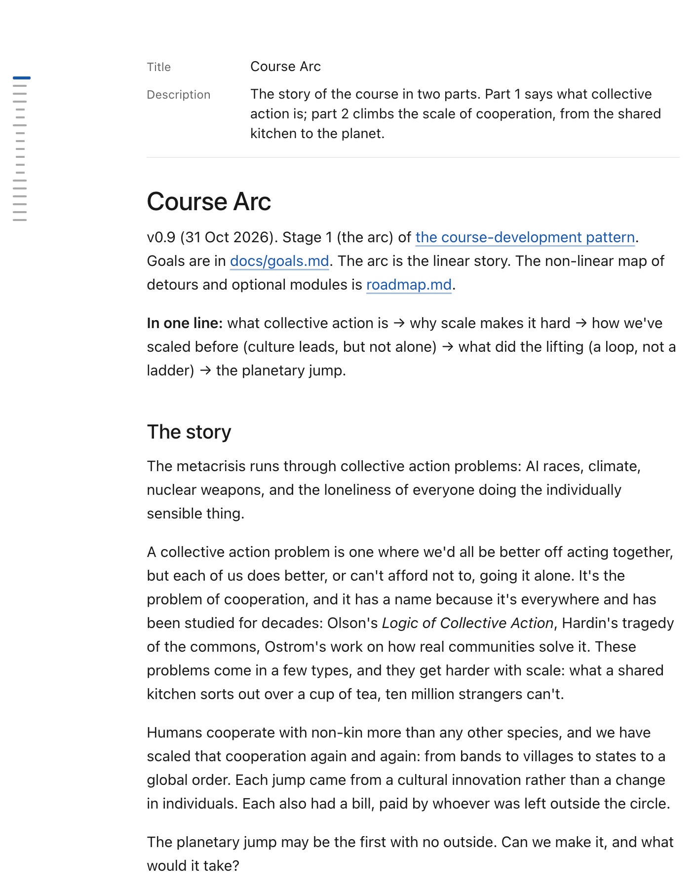
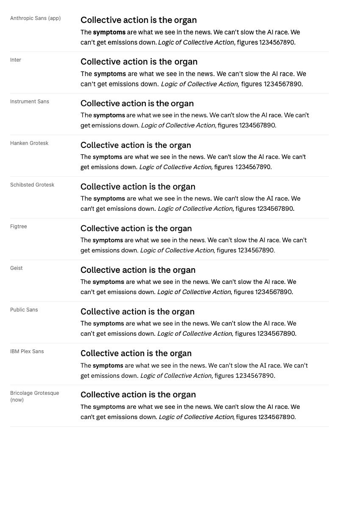
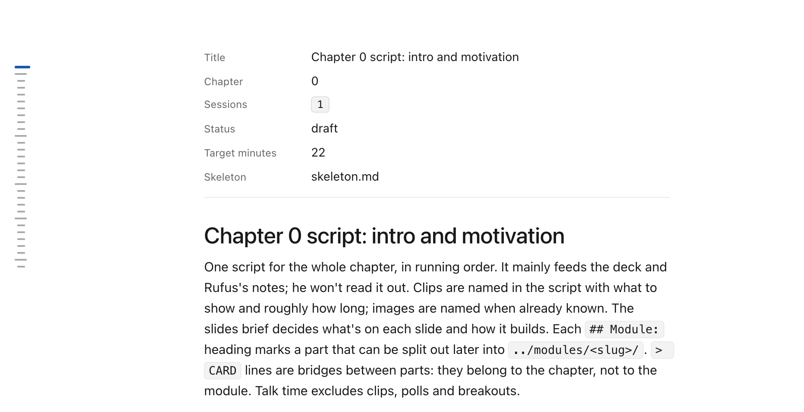
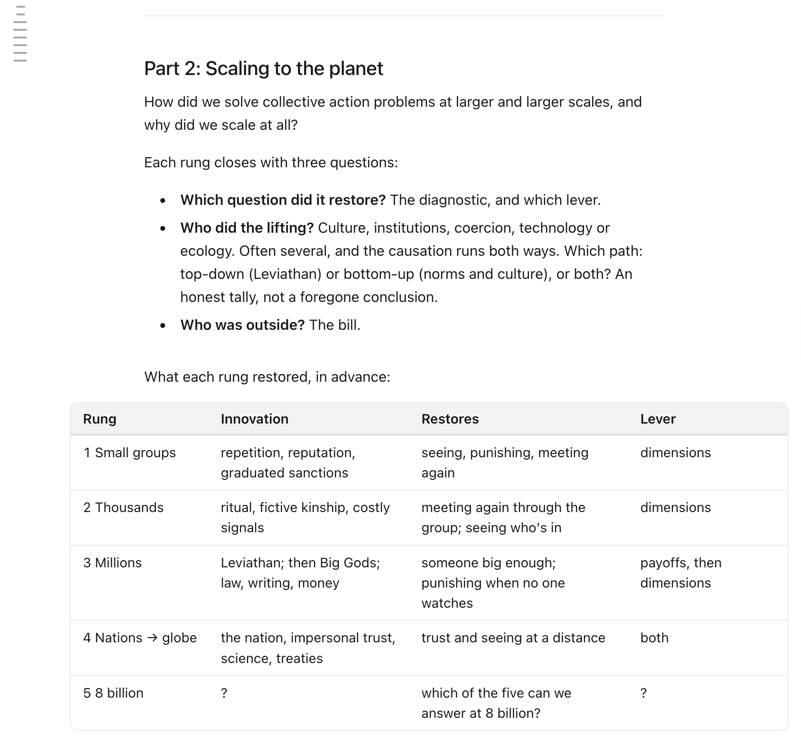
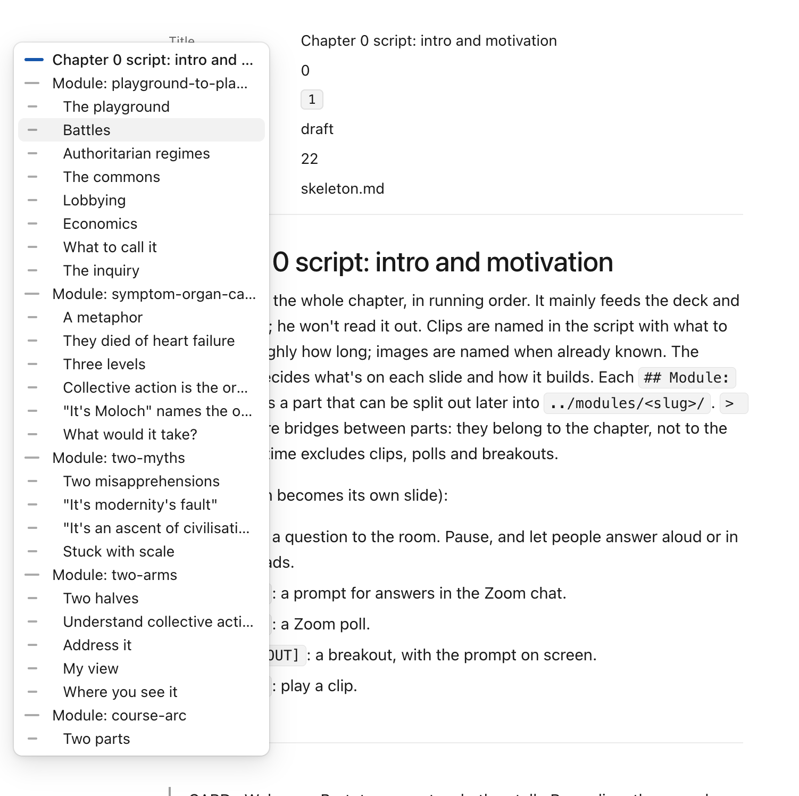
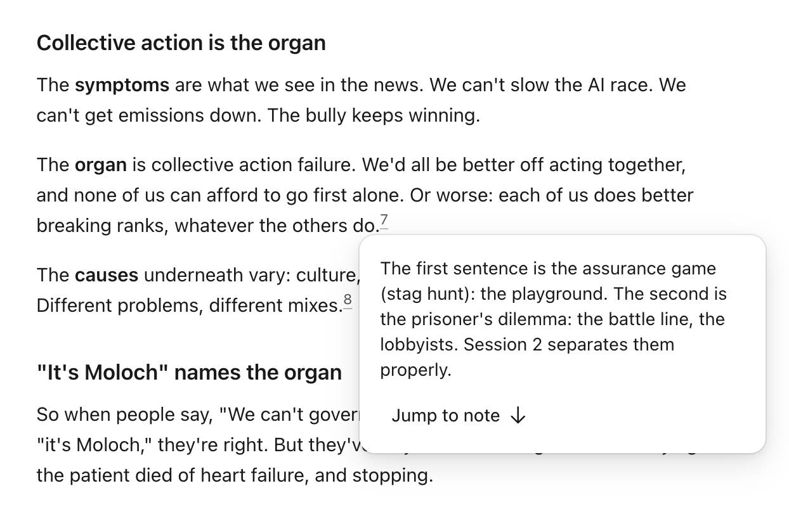

An admiring teardown. The Markdown previewer in the Claude desktop app (the Files pane in the Code tab) reads better than almost any docs or research site. This page works out why, from the app's own stylesheet, and rebuilds it with open fonts so we can borrow it for our [[Flowershow]] research and knowledge-base sites.



**Demo:** [claude-md-previewer/demo.html](claude-md-previewer/demo.html), a rebuild with open fonts. Switch the body font (Inter, Geist, or Literata for a serif), hover the ticks on the left for the contents, click a footnote number.

## TL;DR

It isn't one clever trick. A dozen small choices all favour the text:

- a plain, even sans at **15px on a 24px line** (1.6)
- a **540px column** (36 × body size, about 70 characters)
- headings in the **same face at medium weight**, with space above that grows with rank
- **every border and fill is the ink colour at 5, 10 or 20% opacity**
- frontmatter, contents and footnotes that **stay quiet until you reach for them**

## How I found this

Everything below comes from the app's own CSS, read in place from `/Applications/Claude.app/Contents/Resources/ion-dist.asar` (the Code tab UI). The previewer is the `epitaxy-document-*` component, built on a shared `.prose` stylesheet. Colours come from the app's design tokens (`--cds-gray-*`, `--cds-blue-*`). The fonts ship in `Contents/Resources/fonts/`. Sizes are for the default "Medium" text size. The app screenshots are Rufus's course drafts open in the previewer.

## Fonts

**What it uses**

- **Body, headings, frontmatter and UI: Anthropic Sans**, a variable grotesque with weights 300 to 800. Body weight is 400, headings 500.
- **Serif option: Anthropic Serif.** The code can set documents in serif instead (a font setting), but the default view, as in the screenshots, is sans.
- **Code:** the system mono (SF Mono, then Menlo).

Anthropic Sans is a plain, even grotesque: open shapes, moderate x-height, no quirks. It is neutral enough to disappear at reading size, which is the point. Neither Anthropic face can be reused.

**Why it works:** the face never draws attention to itself, and one family for headings, body and labels keeps the page calm. By contrast, Bricolage Grotesque's quirks (ink traps, wide rounds) are lovely at display sizes but noticeable in long text.

**Open equivalents for the sans** (same paragraph, same size and leading):



| Rank | Face | Licence | Verdict |
|---|---|---|---|
| 1 | **[Inter](https://fonts.google.com/specimen/Inter)** | OFL, Google Fonts | Closest overall: same width (same line breaks), neutral, built for screens, has optical sizes and tabular figures. The safe choice |
| 2 | **[Geist](https://fonts.google.com/specimen/Geist)** | OFL, Google Fonts | Same width again, a touch more geometric and "tech" |
| 3 | [Public Sans](https://fonts.google.com/specimen/Public+Sans) | OFL | Close in rhythm, a little warmer; from the US Web Design System |
| – | Instrument Sans, Hanken Grotesk, Figtree, IBM Plex Sans | OFL | Good faces, but narrower or more characterful than the app's |

For code: **JetBrains Mono** or IBM Plex Mono.

**If you want the serif option.** Anthropic Serif appears to be the house successor to the Copernicus-style serif noted in [[Copernicus font alternatives]]: Plantin-like, wide, big x-height, low contrast. The closest open serifs:


| Rank | Face | Verdict |
|---|---|---|
| 1 | **[Literata](https://fonts.google.com/specimen/Literata)** | Closest in feel: big x-height, sturdy, made for screen reading. About 5% wider |
| 2 | **[Source Serif 4](https://fonts.google.com/specimen/Source+Serif+4)** | Closest in width, a little crisper. Already in our [Reading System](reading-system/) |
| 3 | [Charis SIL](https://fonts.google.com/specimen/Charis+SIL) / [Gelasio](https://fonts.google.com/specimen/Gelasio) | Sturdy fallbacks, less warm |
| – | [Young Serif](https://fonts.google.com/specimen/Young+Serif) | Right for Copernicus-style *headings*, too heavy for body text |

## Size, measure, line height

| | App value | Notes |
|---|---|---|
| Body | `0.9375rem` (15px) | 14px and 16px with the text-size setting |
| Line height | body × 1.6 = 24px | generous, and the main source of the calm |
| Measure | body × 36 = 540px | scales with text size; about 70 characters |
| Side padding | `clamp(1.25rem, 6cqi, 4rem)` | container query units, so it adapts to the pane, not the window |
| Top / bottom padding | `clamp(2rem, 6cqi, 3.5rem)` / `6rem` | room to finish the last paragraph mid-screen |
| Text wrapping | `text-wrap: pretty` on paragraphs, `balance` on headings | no orphan words, no lopsided two-line headings |

**Why it works:** a short measure and tall leading do most of the work. The extra bottom padding means the last lines aren't stuck at the bottom edge.

## Frontmatter



The previewer doesn't hide YAML frontmatter or dump it as code. It shows it as a **quiet two-column list** above the title:

- Keys are humanised: `target_minutes` becomes "Target minutes", first letter capitalised.
- Labels are small and grey; values are plain body text. The label column is as wide as the longest key.
- List values (`sessions: [1]`) become small **mono chips** with a hairline border and a 5% fill.
- A hairline rule underneath, 1em padding and 2em before the title.

**Why it works:** metadata is visible and readable, but clearly not part of the document. Flowershow uses frontmatter for title and description and drops the rest.

## Headings and vertical rhythm

Exact values, at the default 15px body. Sizes are in `em` of the body, so the whole scale moves with the 14/15/16px text-size setting.

| | Ratio to body | px | Step from the one below | Line height | Weight (nominal / variable axis) | Space above |
|---|---|---|---|---|---|---|
| H1 | **1.75** | 26.25 | 1.296 × H2 | 1.15 (30.2px) | 500 / `wght` 460, tracking −0.012em | 3em |
| H2 | **1.35** | 20.25 | 1.2 × H3 | 1.25 (25.3px) | 500 / `wght` 460 | 2.5em |
| H3 | **1.125** | 16.875 | 1.125 × H4 | 1.3 (21.9px) | 600 / `wght` 540 | 2em |
| H4 | **1** | 15 | – | 1.3 (19.5px) | 600 / `wght` 540 | 1.667em |
| Body | **1** | 15 | – | **1.6** (24px) | 400 | 1em between blocks |
| Table text | 0.9375 | 14.06 | | 1.5 | 400, headers 600 | 2em after |
| Footnotes | 0.875 | 13.1 | | inherits | 400, secondary colour | 3em above the section |
| Code (inline and block) | body − 2px | 13 | | 1.54 (20px) in blocks | 400 | |
| Superscripts | 0.75 | 11.25 | | 0 | | |

Notes on the scale:

- It is **not a modular scale**. The steps shrink as you go down (1.3, 1.2, 1.125), so the top heading is clearly a title and the lower ones are barely bigger than the text. H4 is body size, set apart only by weight.
- Line height tightens as size grows: 1.6 for body, 1.3 for small headings, 1.25 for H2, 1.15 for H1.
- Weights are set through the variable font's axis: headings use `wght` 460 (medium) and 540 (semibold), lighter than the nominal 500 and 600. That is part of why the headings feel soft.
- Ratio of body line to body size: 24/15 = 1.6. Measure: 36 × 15 = 540px.

- The flow unit is **1em between blocks**. After a heading the gap is **0.667em**, so a heading clearly belongs to the text under it. Two headings in a row sit 0.9em apart.
- After a table or list the gap grows to 2em, and so does the space before an H3, table or rule. A rule carries its own 2.75em margins.
- Each heading gets a small **anchor link that appears on hover**, just after the text, and is hidden on touch screens.

**Why it works:** headings are *medium*, not bold, and not much bigger than the body. The hierarchy comes from space, not shouting. Most themes (Flowershow's included) make headings too big and too close to the text below.

## Colour

Warm greys on white, one blue, and nothing else.

| Role | Light | Dark |
|---|---|---|
| Text | `#0b0b0b` | `#f0efec` |
| Secondary text, list markers, footnotes | `#52514e` | `#c3c2b7` |
| Muted (read ticks, anchors) | `#898781` | `#898781` |
| Accent (links, current tick) | `#184f95` | `#6da7ec` |
| Borders | ink at 10% (strong 20%, blockquote rule 40%) | the same opacities of the light ink |
| Fills (code, table head) | ink at 5% | |
| Paper | `#fff` | `#1e1e1d` |

The greys have a hint of yellow (for example `#f0efec`, `#c3c2b7`), which keeps the page from feeling clinical.

**Why it works:** deriving every border and tint from the ink colour with opacity means lines and fills never clash, and dark mode comes almost free.

## Links

```css
a { color: var(--accent); text-decoration-line: underline; text-underline-offset: 3px;
    text-decoration-color: color-mix(in srgb, currentColor 65%, transparent); }
a:hover { text-decoration-color: currentColor; }
```

Links are always underlined, but the underline is lighter than the text (about 65% strength: the app mixes 40% of the link colour with a translucent version of it) and sits 3px below the text, so links are clear without breaking up the line. Heading links keep the heading colour and turn blue on hover.

## Lists, blockquotes, rules

- Lists indent by 2em, plus 0.5em of padding on each item. Items sit **a third of a line apart**, with grey markers. Nested markers go disc, circle, square (or 1, a, i).
- **Blockquotes keep the body colour and size**, marked only by a 2px rule at 40%. They stay part of the argument instead of going grey. GitHub-style alerts (`> [!NOTE]`) get a coloured rule and label.
- Rules are a 1px line with 2.75em of space on either side.

## Tables

- Thin outer border (10%), 6px corners, rows divided by hairlines, a **5% tint on the header**, which **sticks** when you scroll a long table.
- 0.9375em text on a 1.5 line, `tabular-nums lining-nums` so figures line up, cells padded 0.5em × 0.875em, headers weight 600 and bottom-aligned.
- Tables size to their content (`width: auto`). Wide ones **bleed out into the margins** rather than squeeze the columns, and scroll sideways only when they still don't fit.



## Code

- Inline: mono at body − 2px (13px), a 5% tint, a 0.5px border at 20%, 4px radius, and **body colour** (not red, as most themes have it).
- Blocks: 13px on a 1.54 line, 5% tint, 0.5px border, **9px radius**, 14px padding, tab size 2.

## Table of contents: the tick rail



The contents is the most distinctive piece:

- **At rest it is a column of short ticks** in the left gutter, one per heading, sticky at the top of the pane. There are no words at rest, so it costs nothing visually.
- **Tick length shows level**: 14px for the top level, 9px for the next, 6px below that. The current tick grows to 18px.
- **State**: unread ticks are faint, ones you have scrolled past are darker, and the current section is **blue and thicker**. It doubles as a progress bar.
- **Hover the rail and the outline opens** as a 15–17rem panel (sans, 13px) with the same ticks beside each title. Click to jump. It has arrow-key navigation and Escape to close.
- It only shows with **three or more headings** and when the gutter is at least 4.75rem wide. On narrow screens there is no contents at all. It fades top and bottom when the outline is longer than the screen.

**Why it works:** you always know where you are, and the full contents is one hover away, with no sidebar taking up a third of the screen.

**Open equivalent:** nothing off the shelf does the rail. [tocbot](https://tscanlin.github.io/tocbot/) (MIT) builds the list and tracks the current heading, so it could drive one. The demo's ~50-line script does the whole thing.

## Footnotes: card, then jump



The card opens on **click**, not hover. That works on touch screens and avoids cards popping up as the pointer passes.

- Markers are small grey superscripts with a faint underline, so they read as links without shouting.
- **Click the number** and the note opens in a **20rem card just below it**, in the body font at a smaller size, with its back-link removed.
- The card has one button, **"Jump to note ↓"**. It scrolls to the note, which flashes a pale blue for 1.6 seconds (`data-landed`) so your eye finds it.
- Click the number again, click outside, press Escape, or **scroll more than a third of a screen away**, and the card closes.
- At the end, the notes sit under a thin rule with 3em of space above, at 0.875em in the secondary colour.

**Why it works:** you read the note without losing your place, and can still go down to the notes when you want to.

**Open equivalent:** [Littlefoot](https://littlefoot.js.org/) (MIT) turns standard Markdown footnotes into click-to-open cards and is close to this out of the box. It lacks the "Jump to note" button and the landing flash; the demo's ~60-line script has both.

## Small things that add up

- Text wraps with `pretty` and `balance` (see above).
- A brief highlight when a passage changes, or when you land on an anchor.
- Print styles hide the rail and buttons and avoid breaking inside code, tables and figures.
- Reduced-motion users get no animation.

## Borrow these (ranked)

Ranked by gain to reading for the effort. The Flowershow change is what each would need on our sites. Flowershow takes fonts and colours through `custom.css` (`--font-body`, `--font-heading`, `--color-l-*`, `--font-size-base`). Site-wide scripts go in the `head` config key (premium, which we have). Per-page scripts use the `scripts` frontmatter.

1. **Body type: a plain sans at 15–16px on a 1.6 line.** Use Inter (or Geist) instead of Bricolage Grotesque for body text, headings and labels. *Flowershow:* `@import` the Google Fonts line, set `--font-body` and `--font-size-base`, and set `line-height: 1.6` on `.prose` (or the theme's content class) in `custom.css`.
2. **A 36em measure (about 540–580px).** *Flowershow:* check the theme's column width; set `max-width: 36em` on the article body in `custom.css` (or use `layout: plain` with our own wrapper).
3. **Footnote card: click to open, "Jump to note", flash on landing.** The biggest UX gain for research pages. *Flowershow:* Flowershow renders GFM footnotes as plain links to the end of the page. Add [Littlefoot](https://littlefoot.js.org/) or the demo's ~60-line script through `head`, plus its CSS. This would also be a good upstream feature for Flowershow itself.
4. **Quiet headings with rank-based spacing.** Same family, weight 500/600, sizes 1.75/1.35/1.125em, space above 3/2.5/2em and 0.667em below. *Flowershow:* about 15 lines of `custom.css`. Set `--font-heading` to the body face.
5. **Frontmatter as a quiet field list** above the title, with list values as chips. *Flowershow:* not possible in CSS, as Flowershow doesn't render other frontmatter fields. Either a small script reading a data block, or ask Flowershow for a `showFrontmatter` option. Most useful for knowledge-base and project pages.
6. **Ink-derived colour: warm near-black, warm greys, one accent, borders and fills as 5/10/20% of the ink.** *Flowershow:* set `--color-l-foreground`, `--color-l-accent` and the dark equivalents, then restyle borders in `custom.css` with `color-mix()`.
7. **Light underlined links** (about 65% underline, 3px offset, full on hover). *Flowershow:* five lines of `custom.css`.
8. **Calm tables and code:** tinted sticky header, hairline rows, tabular figures; inline code in body colour with a faint box. *Flowershow:* `custom.css` only.
9. **Tick-rail contents** with current and read states, outline on hover. The most distinctive piece, and the most work. *Flowershow:* turn off the built-in contents (`showToc: false`) and add the demo's rail script and CSS through `head`. Show it only on pages with three or more headings. Try it on one long page first. On phones, keep Flowershow's own contents or none.
10. **Finishing touches:** `text-wrap: pretty/balance`, heading anchors on hover, 6rem bottom padding, print rules. *Flowershow:* `custom.css`. Anchors need a small script, or a check whether Flowershow already adds them.

Items 1, 2, 4, 6–8 and 10 are pure CSS and could become one `custom.css` for the research-site house style. Items 3, 5 and 9 need a script. The brief for that house style is in the design repo: `projects/2640-research-site-style.md`.

## See also

- [[Copernicus font alternatives]]: the earlier Claude.ai heading font and Young Serif
- [Reading System](reading-system/): our essay stylesheet (sidenotes, themes)
- [[typography]]
