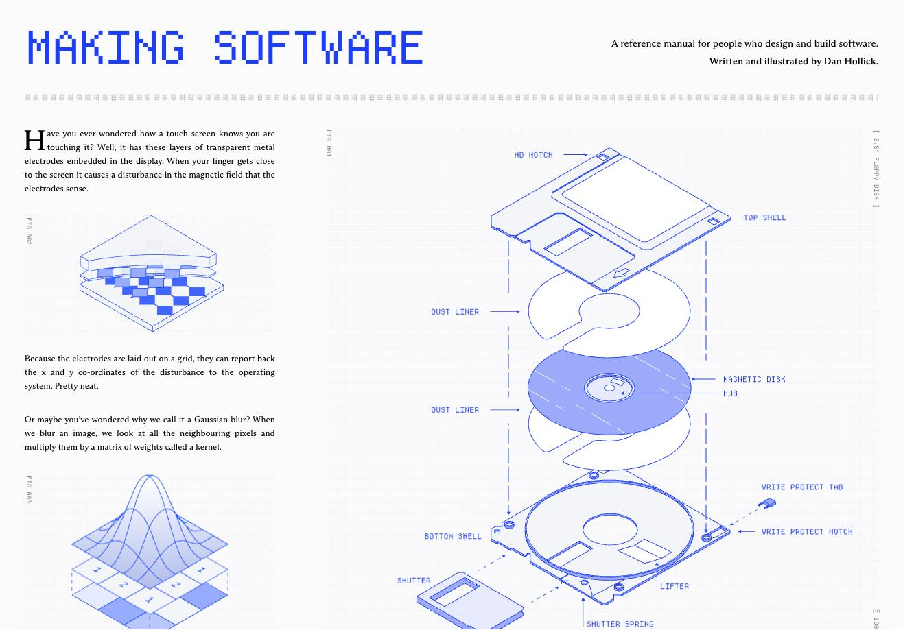
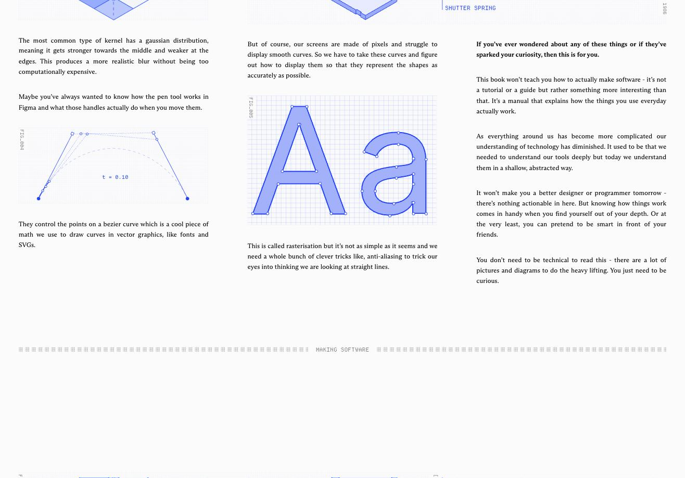
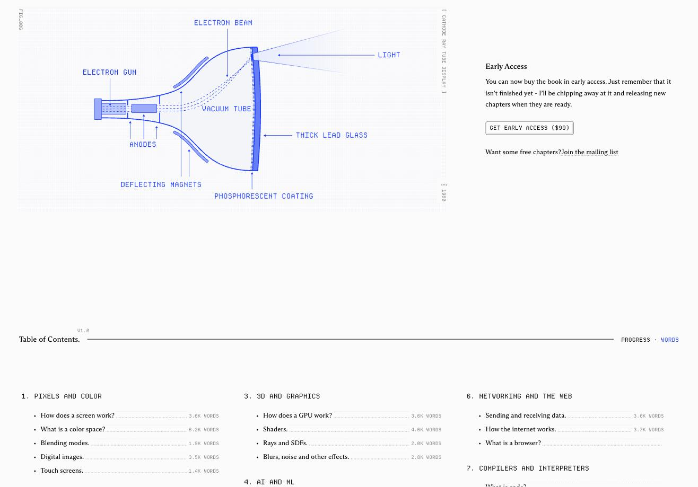
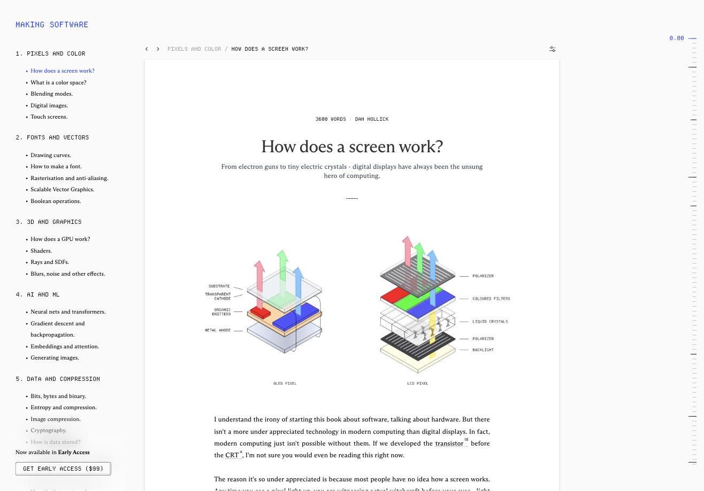
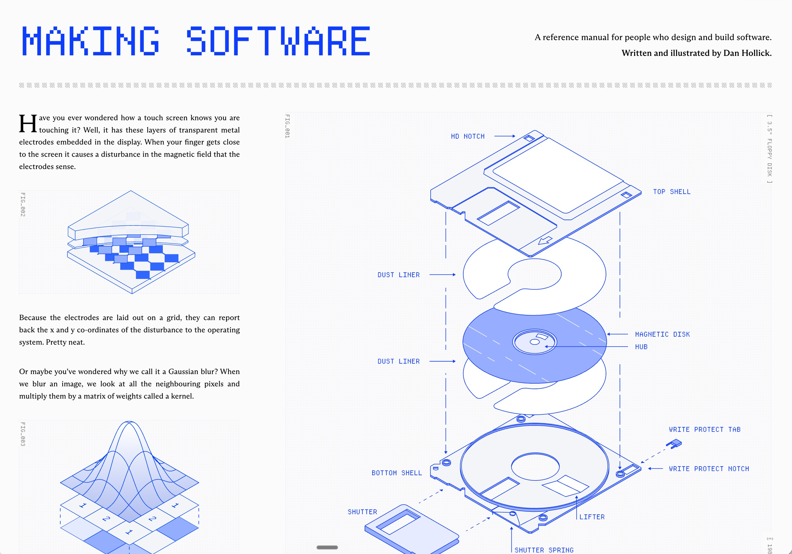

Beautiful, elegant technical reference manual — blueprint-style illustrations, pixel-font animated logo, and a calm editorial layout.

https://www.makingsoftware.com/

Written and illustrated by Dan Hollick: "a reference manual for people who design and build software." Explains how everyday tech works (screens, color spaces, Bézier curves, GPUs, networking) through diagrams more than prose.

## What I love

- **Illustrations.** Isometric, exploded-view technical drawings (a floppy disk, a CRT, OLED vs LCD pixels) in a single blue monochrome palette, with monospace callout labels, `FIG_001` captions and thin leader lines. Incredible, and they do the heavy lifting.
- **Animated logo.** The pixel-font "MAKING SOFTWARE" wordmark at the top is animated. Several illustrations animate too (e.g. the Bézier handles sweeping `t = 0.10 → 0.26`, the `Aa` glyph rasterising from pixels to smooth curves). Video capture isn't practical here, so open the site to see it.
- **Overall feel.** Pale grid-paper background, serif body text with a drop cap, mono for labels and nav, dotted-leader table of contents with word counts. Technical but warm.
- **Chapter pages.** Sticky left nav grouped by topic, breadcrumb, single narrow reading column, hover footnotes, a ruler-style scroll indicator on the right.

## Why it's in the archive

A model for documentation or any technical, explanatory site: a really well put-together, more technical-oriented design that is still pleasant to read. Good reference for writing papers, docs and reports too.

## Screenshots (own Chrome)

Older full-page capture: 

#technical #docs #illustration #editorial #animation
