# SEO Preview Images

Map of content and moodboard for link previews: the image, title and description that appear when a URL is pasted into Slack, Zoom, X, LinkedIn, WhatsApp or iMessage. These come from the Open Graph `og:image` and `twitter:card` tags.

The images here are each site's actual `og:image`, fetched 2026-10-23. Started from [Luma](./luma.com-event.md), whose event previews look great in Zoom chat:

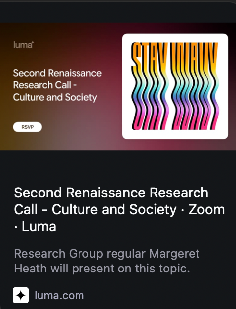

## What makes a good one

- **It's generated from the page, not a site-wide logo.** The best ones (Luma, GitHub, Maggie Appleton) are one template filled per page, so every link has its own preview.
- **It's a composed card, not a raw photo.** Big title, one small brand mark, one image or illustration. Readable at about 300px wide, the size it shows in chat.
- **Key content sits in the centre.** Platforms crop differently (see below).
- **One idea, high contrast.** Busy screenshots turn to mush at thumbnail size.
- **Title and description work without the image:** `Page title · Site` plus one human sentence.

## Generated per page: the card is built from the page's own data

The strongest pattern. One template, filled per page with title, description, stats or a poster. Every link gets its own good preview without anyone designing it.

  

    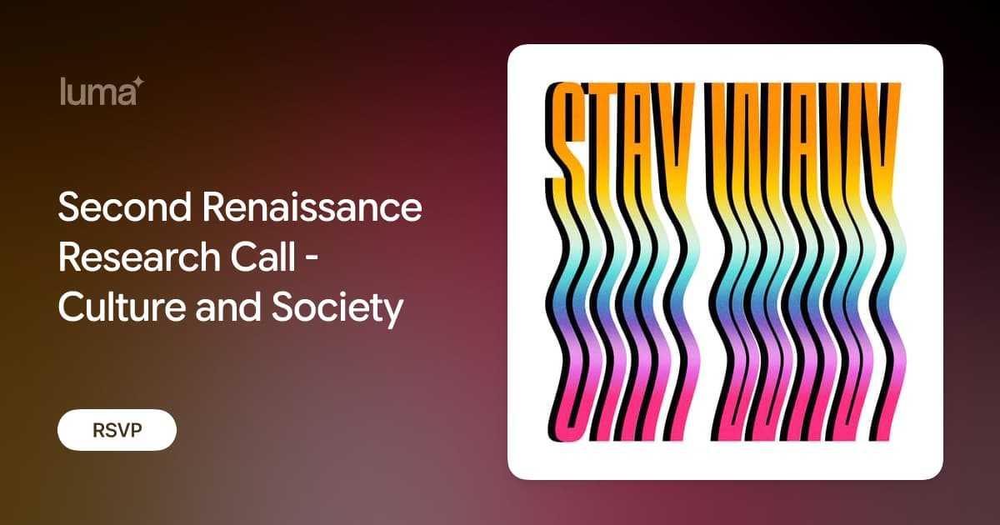
    

      <h3 class="font-semibold text-base">Luma event</h3>
      
Event title + RSVP pill + the event's poster framed on the right. Dark gradient pulled from the poster.

      <a href="https://luma.com/s4gq0lbr" class="text-xs text-blue-500 mt-2 block">luma.com →</a>
    

  

  

    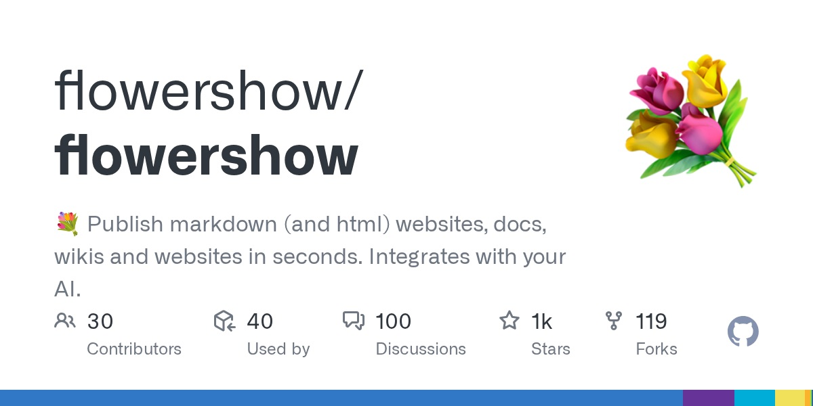
    

      <h3 class="font-semibold text-base">GitHub repo (default)</h3>
      
Owner/repo in big type, description, avatar, then contributors / issues / stars / forks. Information-dense but calm.

      <a href="https://github.com/flowershow/flowershow" class="text-xs text-blue-500 mt-2 block">github.com →</a>
    

  

  

    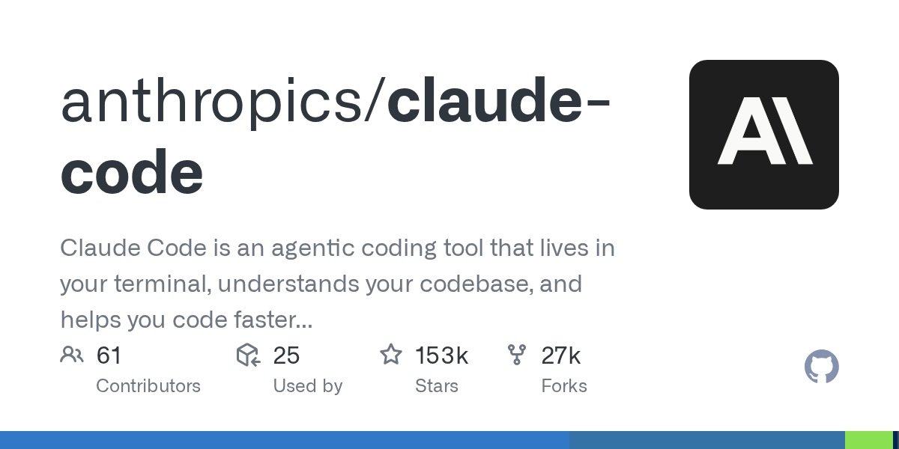
    

      <h3 class="font-semibold text-base">GitHub repo (another)</h3>
      
Same template; the org avatar is the only branding. Shows how consistent a generated card can be.

      <a href="https://github.com/anthropics/claude-code" class="text-xs text-blue-500 mt-2 block">github.com →</a>
    

  

  

    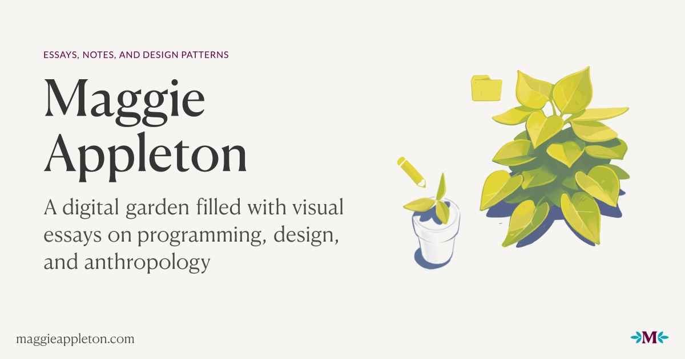
    

      <h3 class="font-semibold text-base">Maggie Appleton</h3>
      
Serif title, short description and a hand-drawn plant, from a generated `/og.png?title=…&description=…`. Garden-like and personal.

      <a href="https://maggieappleton.com/" class="text-xs text-blue-500 mt-2 block">maggieappleton.com →</a>
    

  

  

    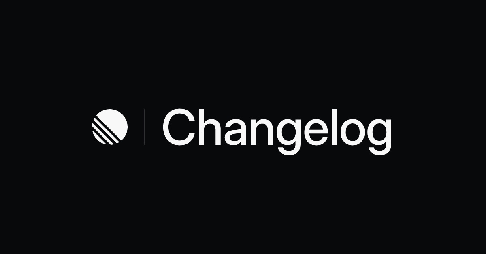
    

      <h3 class="font-semibold text-base">Linear changelog</h3>
      
`/api/og/generic?title=Changelog`: logo + one word on black. Austere template that works for every page.

      <a href="https://linear.app/changelog" class="text-xs text-blue-500 mt-2 block">linear.app →</a>
    

  

## Illustrated and editorial

A commissioned picture. Reads as a magazine cover, so it stands out in a feed of screenshots.

  

    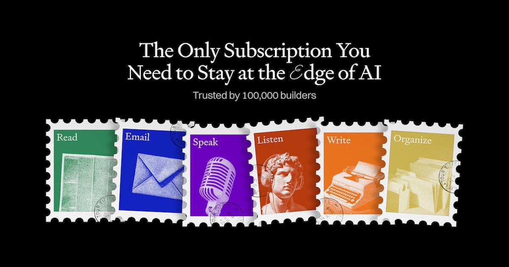
    

      <h3 class="font-semibold text-base">Every</h3>
      
Row of illustrated postage stamps under a serif headline. Editorial, warm, very un-SaaS.

      <a href="https://every.to/" class="text-xs text-blue-500 mt-2 block">every.to →</a>
    

  

  

    
    

      <h3 class="font-semibold text-base">Cloudflare blog post</h3>
      
Each post gets its own flat illustration in a fixed pastel style. Recognisable before you read the title.

      <a href="https://blog.cloudflare.com/" class="text-xs text-blue-500 mt-2 block">blog.cloudflare.com →</a>
    

  

  

    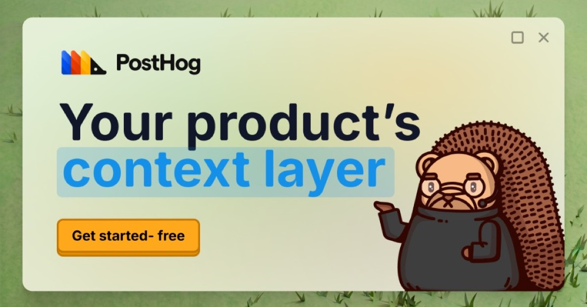
    

      <h3 class="font-semibold text-base">PostHog</h3>
      
Their hedgehog mascot plus a big yellow headline. Brand-led and funny, and consistent across the site.

      <a href="https://posthog.com/blog" class="text-xs text-blue-500 mt-2 block">posthog.com →</a>
    

  

  

    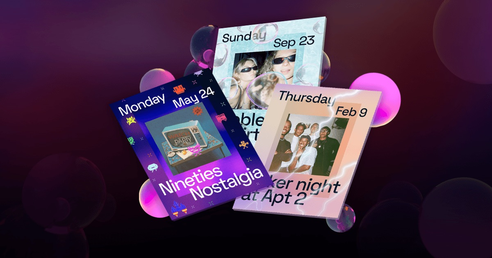
    

      <h3 class="font-semibold text-base">Partiful</h3>
      
Collage of real event flyers. Sells the product by showing what users make.

      <a href="https://partiful.com/" class="text-xs text-blue-500 mt-2 block">partiful.com →</a>
    

  

  

    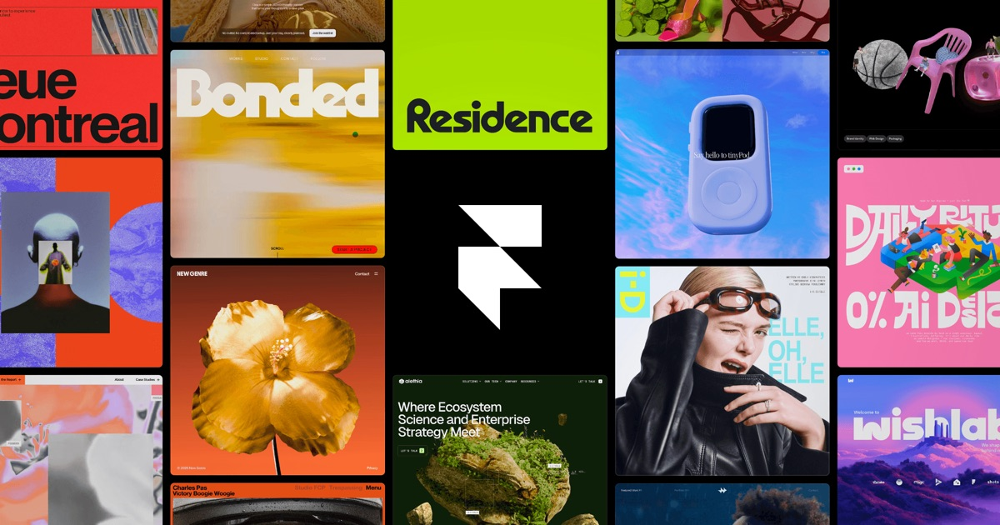
    

      <h3 class="font-semibold text-base">Framer</h3>
      
Grid of sites made with Framer: the gallery is the pitch.

      <a href="https://www.framer.com/" class="text-xs text-blue-500 mt-2 block">framer.com →</a>
    

  

## Product UI as the image

A cropped, polished screenshot. Fine for landing pages; weaker for content pages.

  

    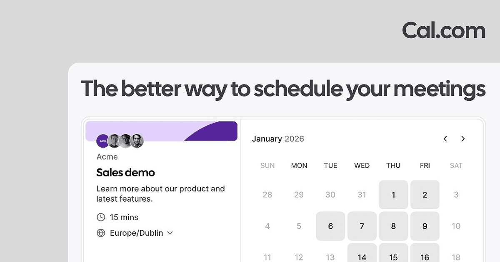
    

      <h3 class="font-semibold text-base">Cal.com</h3>
      
Headline left, booking UI right, on white. Clear and quiet.

      <a href="https://cal.com/" class="text-xs text-blue-500 mt-2 block">cal.com →</a>
    

  

  

    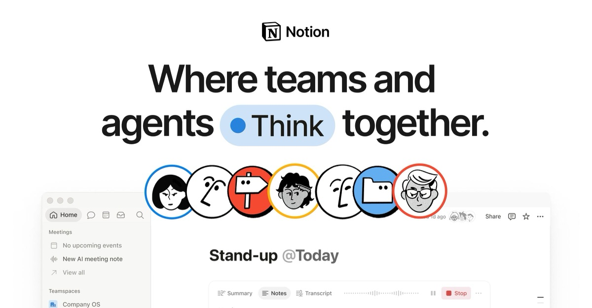
    

      <h3 class="font-semibold text-base">Notion</h3>
      
Headline with a highlighted word, a row of avatars, the product underneath.

      <a href="https://www.notion.com/" class="text-xs text-blue-500 mt-2 block">notion.com →</a>
    

  

  

    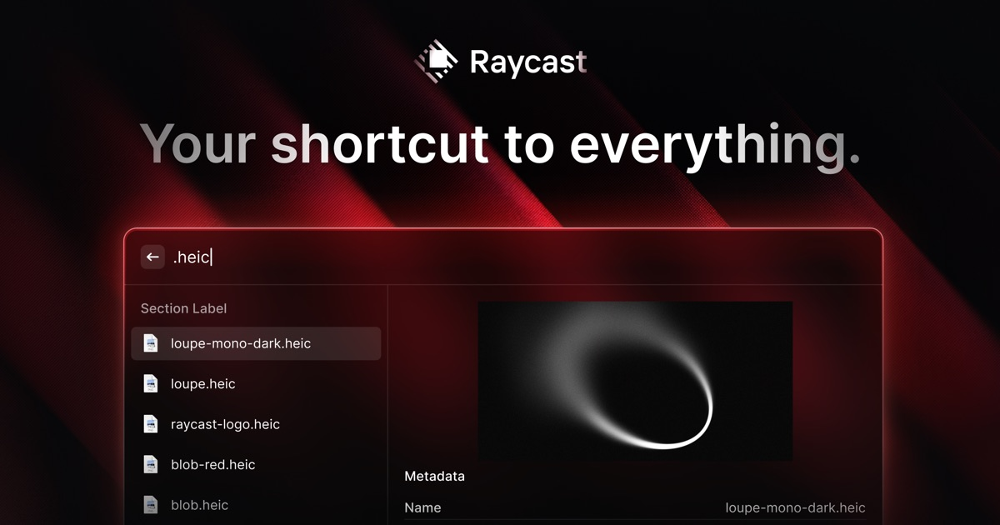
    

      <h3 class="font-semibold text-base">Raycast</h3>
      
Dark product shot with glow; the command bar is the hero.

      <a href="https://www.raycast.com/" class="text-xs text-blue-500 mt-2 block">raycast.com →</a>
    

  

  

    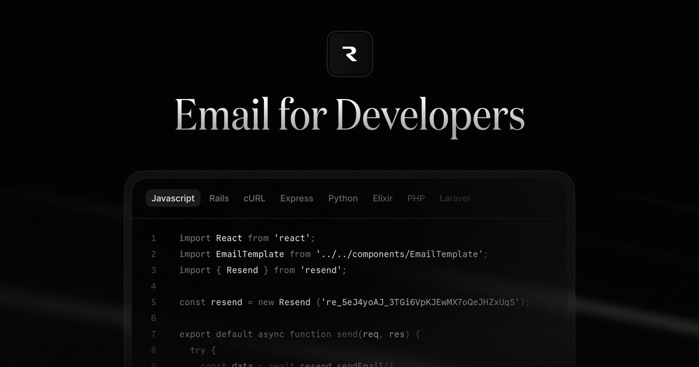
    

      <h3 class="font-semibold text-base">Resend</h3>
      
Black, one line of type, faint code. Developer-premium.

      <a href="https://resend.com/" class="text-xs text-blue-500 mt-2 block">resend.com →</a>
    

  

## Minimal brand mark

Just the logo or one line. Safe and elegant, but every page looks the same, so it says nothing about the page being shared.

  

    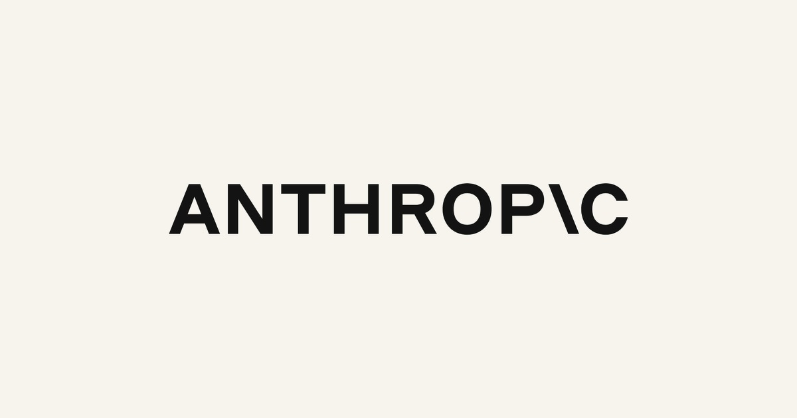
    

      <h3 class="font-semibold text-base">Anthropic</h3>
      
Wordmark on warm off-white. Quiet confidence.

      <a href="https://www.anthropic.com/" class="text-xs text-blue-500 mt-2 block">anthropic.com →</a>
    

  

  

    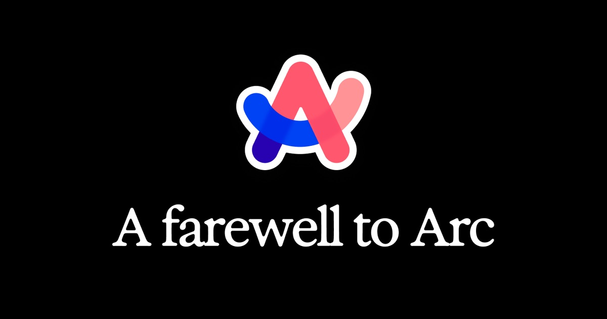
    

      <h3 class="font-semibold text-base">Arc (farewell)</h3>
      
Logo + one serif line on black: "A farewell to Arc". A minimal card can still carry a message.

      <a href="https://arc.net/" class="text-xs text-blue-500 mt-2 block">arc.net →</a>
    

  

  

    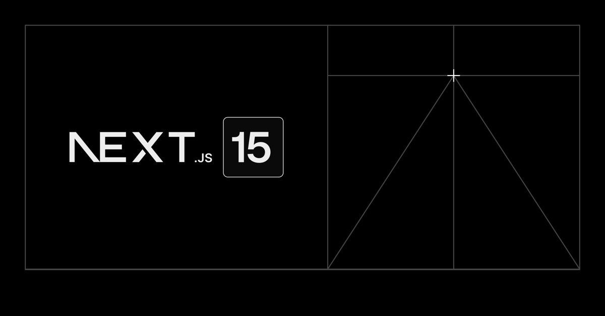
    

      <h3 class="font-semibold text-base">Next.js 15</h3>
      
Version lock-up with thin construction lines. Turns a release into an event.

      <a href="https://nextjs.org/blog/next-15" class="text-xs text-blue-500 mt-2 block">nextjs.org →</a>
    

  

  

    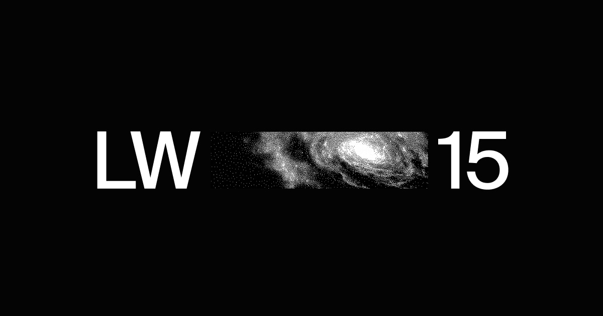
    

      <h3 class="font-semibold text-base">Supabase Launch Week 15</h3>
      
"LW 15" with a 3D object between. Campaign identity.

      <a href="https://supabase.com/launch-week" class="text-xs text-blue-500 mt-2 block">supabase.com →</a>
    

  

  

    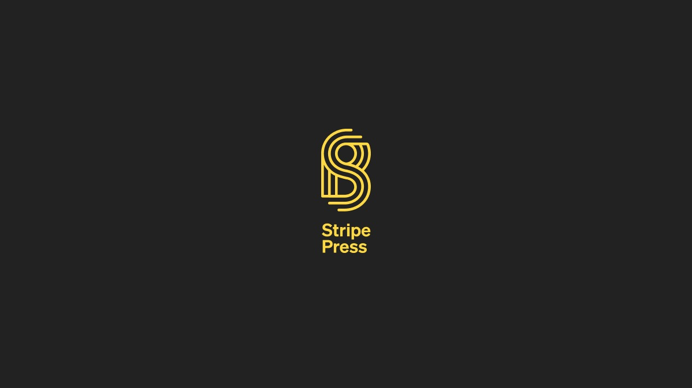
    

      <h3 class="font-semibold text-base">Stripe Press</h3>
      
Tiny gold mark on black. Bookish restraint, maybe too small to read at chat size.

      <a href="https://press.stripe.com/" class="text-xs text-blue-500 mt-2 block">press.stripe.com →</a>
    

  

  

    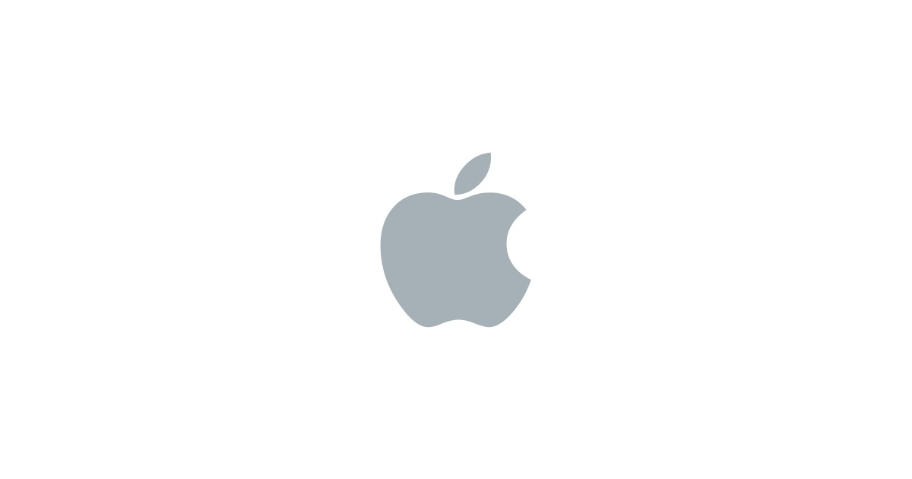
    

      <h3 class="font-semibold text-base">Apple</h3>
      
Grey apple on white. The far end of minimal.

      <a href="https://www.apple.com/" class="text-xs text-blue-500 mt-2 block">apple.com →</a>
    

  

## The content is the image

Media sites just use the thing itself. Hard to beat when you have it.

  

    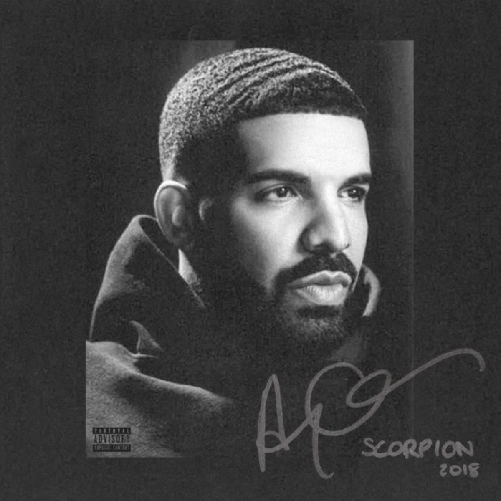
    

      <h3 class="font-semibold text-base">Spotify album</h3>
      
The album cover, square, full bleed.

      <a href="https://open.spotify.com/" class="text-xs text-blue-500 mt-2 block">open.spotify.com →</a>
    

  

  

    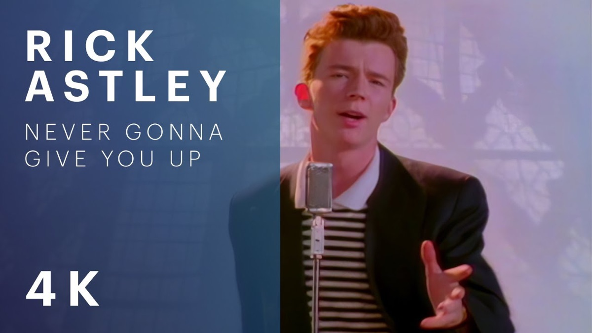
    

      <h3 class="font-semibold text-base">YouTube</h3>
      
The video thumbnail at max resolution.

      <a href="https://www.youtube.com/" class="text-xs text-blue-500 mt-2 block">youtube.com →</a>
    

  

## Counter-examples

What to avoid.

  

    
    

      <h3 class="font-semibold text-base">Substack publication home</h3>
      
400×400 logo, which platforms show as a small thumbnail or stretch. Individual Substack posts do better.

      <a href="https://www.lennysnewsletter.com/" class="text-xs text-blue-500 mt-2 block">lennysnewsletter.com →</a>
    

  

  

    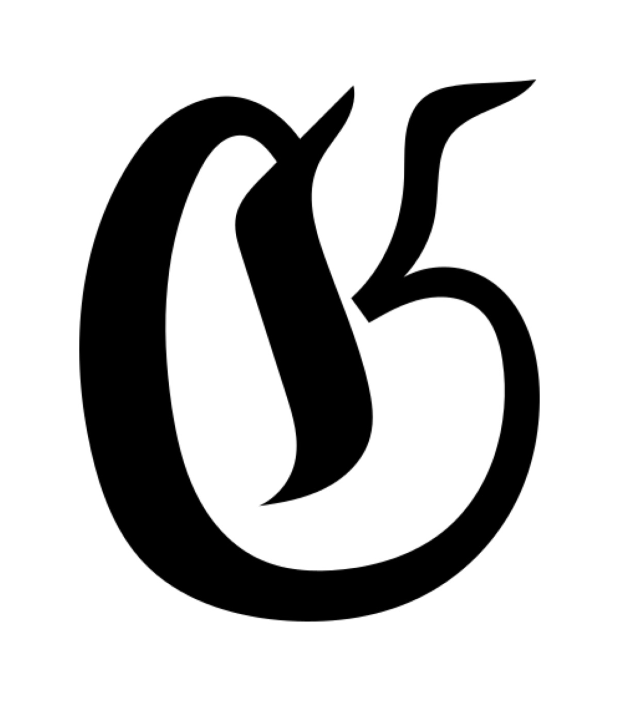
    

      <h3 class="font-semibold text-base">Gwern</h3>
      
Tall 1238×1400 logo: the wrong shape for a 1.91:1 slot, so it gets cropped or letterboxed. The site is lovely; the card isn't.

      <a href="https://gwern.net/" class="text-xs text-blue-500 mt-2 block">gwern.net →</a>
    

  

  

    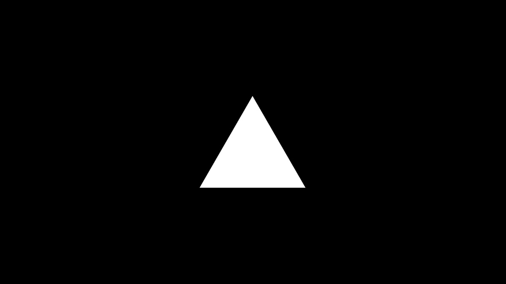
    

      <h3 class="font-semibold text-base">Vercel blog post</h3>
      
The post falls back to the site-wide triangle, so every post looks the same. Missed chance.

      <a href="https://vercel.com/blog" class="text-xs text-blue-500 mt-2 block">vercel.com →</a>
    

  

## Sizes and crops

- **Make it 1200×630 (1.91:1).** It's the common default: Facebook, LinkedIn, Slack, Discord and X `summary_large_image` all take it. Retina-minded sites (Raycast, Anthropic, Framer) serve 2400×1260.
- Add `og:image:width` / `og:image:height` so platforms can lay out the card before the image loads.
- `twitter:card` = `summary_large_image` for the big card; `summary` gives a small square thumbnail.
- **Crops vary by platform.** Zoom chat and X are wide; WhatsApp and iMessage often crop square or show a thumbnail. Luma's own image shows the problem. Here is the same image at 1200×630 and cropped square by its CDN:

  
  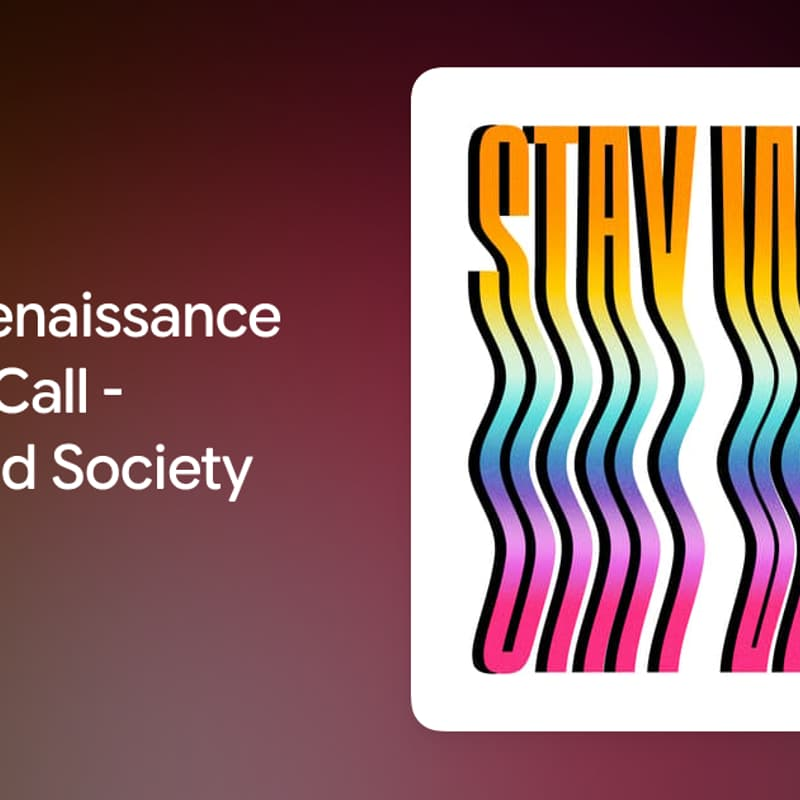

  The square crop cuts the title. Keep the essentials in the centre square (about 630×630) if WhatsApp matters.

## Tools

- Preview across platforms: [opengraph.xyz](https://www.opengraph.xyz/), [LinkedIn Post Inspector](https://www.linkedin.com/post-inspector/), and paste the link into a Slack DM to yourself.
- Generate per page: [Vercel OG / `@vercel/og`](https://vercel.com/docs/og-image-generation) (JSX to PNG, used by Next.js `opengraph-image`), [Satori](https://github.com/vercel/satori), or a Cloudflare Worker. Luma and Linear both use a URL-parameterised endpoint (`/og?title=…`).
- Resize on the fly: Luma serves one master image through Cloudflare image resizing (`width=,height=,fit=cover`).

## How to add an example

Fetch the page's `og:image` (e.g. `curl -sL URL | grep og:image`), save it to `images/{slug}.jpg` at 1200px wide, and add a card to the right section. If you have a screenshot of how the preview looked in a real chat, add that too; it shows the crop, which the raw image doesn't.
