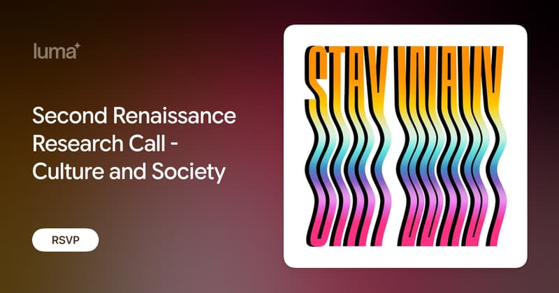

Luma event pages make a lovely link preview: the event poster set beside a dark title block, so it reads as a card even where the platform crops it differently.

https://luma.com/s4gq0lbr

## How it looks

In a Zoom chat (roughly square-ish card, image on top, title and description below):


The raw `og:image` Luma serves (800×420, about 1.9:1):



## Why it works

- The image is a composed card, not a bare poster: Luma wordmark, event title in large type, an "RSVP" pill, and the poster as a framed tile on the right. It still reads as an event invite when the preview is shrunk.
- Title is `Event name · Host · Luma`, so the source is clear even if the image fails.
- Description is one human sentence about who is presenting, no boilerplate.
- Looks good in Zoom, where the crop differs from Twitter/Slack.

## The tags

```html
<meta property="og:title" content="Second Renaissance Research Call - Culture and Society · Zoom · Luma">
<meta property="og:description" content="Research Group regular Margeret Heath will present on this topic.">
<meta property="og:type" content="article">
<meta property="og:image" content="https://images.lumacdn.com/cdn-cgi/image/format=auto,fit=cover,dpr=1,anim=false,background=white,quality=75,width=800,height=420/event-social/8x/....png">
<meta property="og:image:width" content="800">
<meta property="og:image:height" content="420">
<meta name="twitter:card" content="summary_large_image">
<meta name="twitter:image" content="(same as og:image)">
```

Notes:
- The image is generated per event and resized on the fly by a CDN (Cloudflare image resizing: `width=800,height=420,fit=cover`). Change those params to get other proportions, e.g. square or 1200×630, and see how each looks.
- `twitter:card=summary_large_image` asks for the big card rather than a thumbnail.

#seo #og-image #link-preview #events
