# How previews vary from page to page

[SEO Preview Images](./README.md) shows each site's home page. This page asks the more useful question: **what does the preview look like on the site's ordinary pages** (blog posts, docs pages, wiki notes)? On a blog or knowledge base it's the inner pages that get shared.

Method: for 26 blogs, docs sites and wikis, I took the `og:image` of 2–3 inner pages each (2026-10-26) and put them side by side. Each row below is one site. Click an image to open the page.

## TL;DR

Sites use one of four strategies, or combine them:

1. **Same image everywhere.** Every page shares the logo card. Zero variation (MDN; Anthropic news, mostly).
2. **One template, new art per post.** A fixed frame (logo, title position, colours) with a new picture each time (Cloudflare, Vercel, Stripe, Supabase). The best look, but someone has to make the art.
3. **Generated text card.** A template filled from the page's title, description and section, with no picture (Obsidian Help, Next.js, Astro, Mintlify, Tailwind, Stripe Docs, Life Itself). This is how docs and wikis get variety for free.
4. **Image from the page itself.** The first figure, lead image, chart or cover (Gwern, Wikipedia, Our World in Data, LessWrong, Flowershow blog). Great when there is one; when there isn't, you fall back to the logo or get nothing.

**The answer for Flowershow-like sites is to combine them:** use the page's own image when it has one, otherwise a generated card (Linear does this).

## 1. Same image everywhere

The preview tells you nothing about the page. Fine for a home page, a waste on a post.

### MDN

Same logo card on every docs page, even though each page has a clear title and section.

  <a href="https://developer.mozilla.org/en-US/docs/Web/HTML/Element/meta"> HTML metadata element - HTML | MDN" title="<meta> HTML metadata element - HTML | MDN" class="w-full rounded border border-gray-200" /></a>
  
  

### Anthropic news

Mostly the wordmark. Only some posts get their own art (middle).

  
  
  <a href="https://www.anthropic.com/news/cyber-verification-program">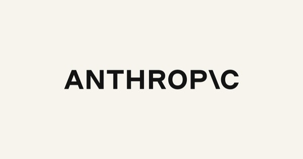</a>

## 2. One template, new art per post

A fixed frame makes the brand obvious; new art inside it makes each post its own. Needs a designer or an illustration habit.

### Cloudflare blog

The clearest system: logo top-left, title left, an illustration right. Light or dark per post.

  
  <a href="https://blog.cloudflare.com/post-quantum-geo-key-manager/">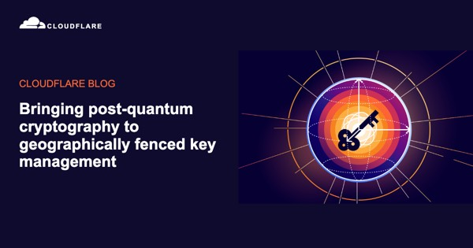</a>
  

### Vercel blog

Black, triangle, title, plus a product drawing. Very consistent.

  
  
  

### Stripe blog

Gradient field, title, sometimes a product shot.

  <a href="https://stripe.com/blog/trends-from-money20-20-2026-the-rise-of-hidden-financial-services">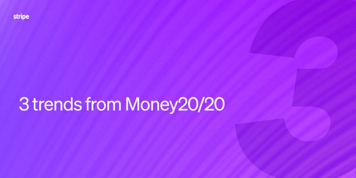</a>
  <a href="https://stripe.com/blog/new-ways-for-fintechs-to-move-money-and-expand-globally">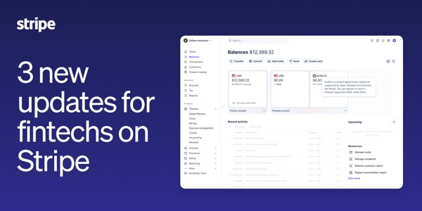</a>
  <a href="https://stripe.com/blog/real-time-stripe-data-postgres">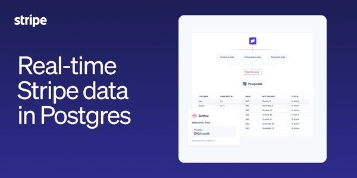</a>

### Supabase blog

Dark, green accent, title plus UI or code.

  <a href="https://supabase.com/blog/give-your-supabase-app-its-own-mcp-server">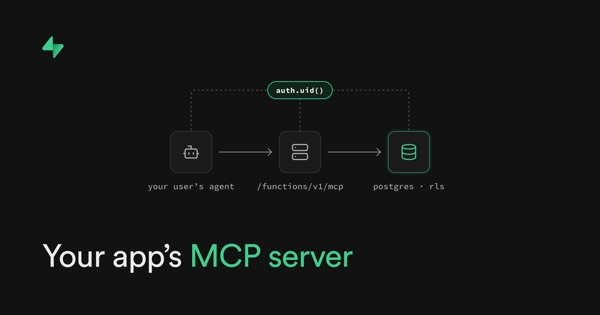</a>
  <a href="https://supabase.com/blog/getting-started-with-the-supabase-dotnet-sdk">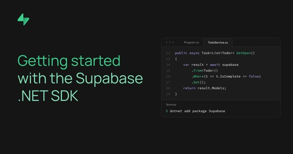</a>
  <a href="https://supabase.com/blog/operate-with-confidence-check-production-with-your-coding-agent">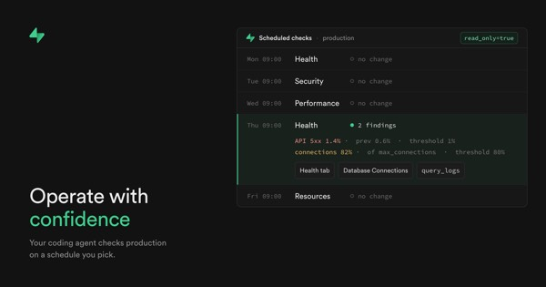</a>

### GitHub blog

Topic art reused across posts (AI, Copilot, generic Mona). Varies by category, not by post.

  
  
  

### Fully bespoke art

No frame, just a commissioned image or a hand-made title card per post.

### Every

A new editorial illustration for every piece. The magazine end of the scale.

  
  
  <a href="https://every.to/vibe-check/vibe-check-duet-anthropic-s-always-on-agent">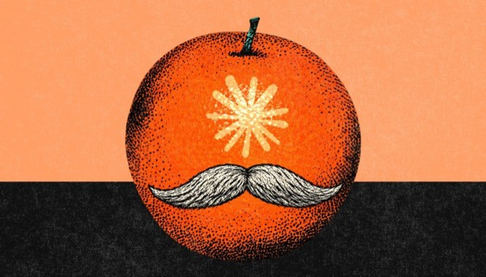</a>

### Josh Comeau

Hand-made per post: big title, a code-y background and his avatar. Unmistakably him.

  <a href="https://www.joshwcomeau.com/css/interop-2027/">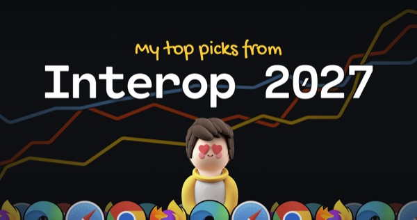</a>
  
  <a href="https://www.joshwcomeau.com/animation/scroll-driven-animations/">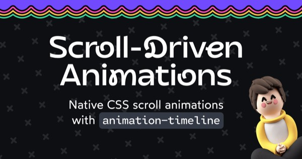</a>

### Hugging Face blog

Each author makes a thumbnail, so quality varies, but the emoji mascot holds it together.

  
  
  

## 3. Generated text card

The docs and wiki answer: one template, filled from title, description and section. Every page gets a distinct preview with zero effort. Usually a dark or light field with the logo, a big title, a one-line description and often the section name.

### Obsidian Help

Title, the page's first sentence, logo. `ogimage.obsidian.md/og-image.png?title=…&description=…`. A text-only wiki that still previews well.

  <a href="https://help.obsidian.md/Home">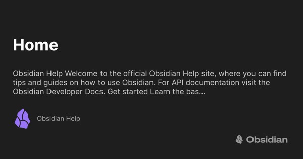</a>
  <a href="https://help.obsidian.md/Files+and+folders/Accepted+file+formats">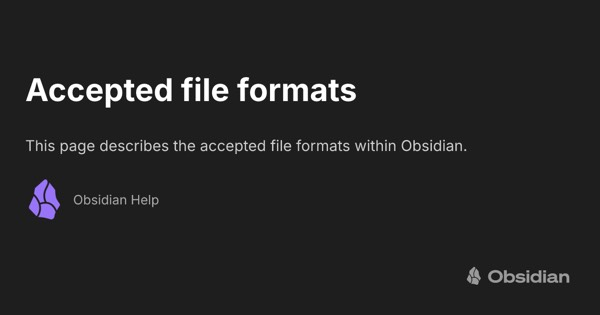</a>
  <a href="https://help.obsidian.md/Plugins/Graph+view">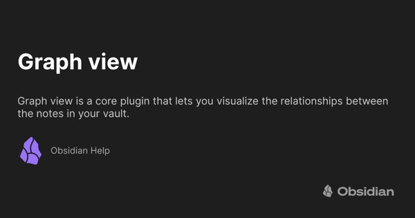</a>

### Next.js docs

Title plus section ("Getting Started", "Functions"). Signed URL so nobody can render arbitrary text.

  
  <a href="https://nextjs.org/docs/app/api-reference/functions/generate-metadata">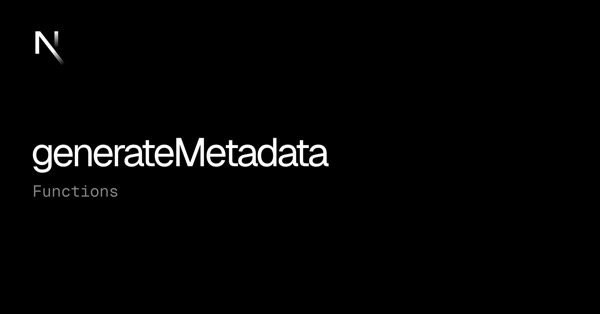</a>
  

### Astro docs

Pre-rendered at build time (`/open-graph/en/….webp`). Title, description, purple edge.

  <a href="https://docs.astro.build/en/getting-started/">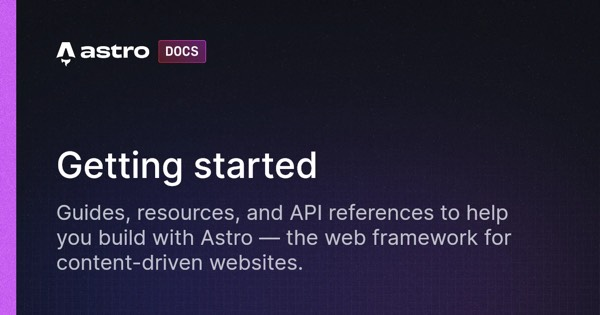</a>
  <a href="https://docs.astro.build/en/guides/markdown-content/">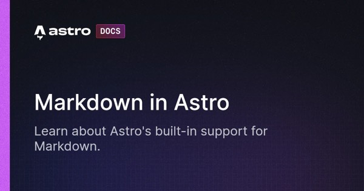</a>
  <a href="https://docs.astro.build/en/guides/images/">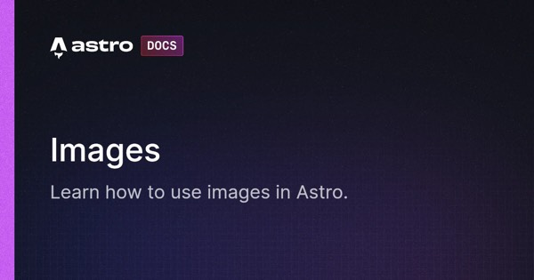</a>

### Mintlify

Section ("Get started", "Formatting"), title and description. Every Mintlify docs site gets this.

  
  
  

### Tailwind docs

Section, title, description, version badge, over faint construction lines.

  <a href="https://tailwindcss.com/docs/installation">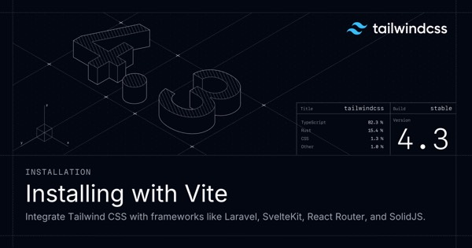</a>
  <a href="https://tailwindcss.com/docs/font-size">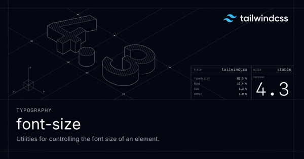</a>
  <a href="https://tailwindcss.com/docs/grid-template-columns">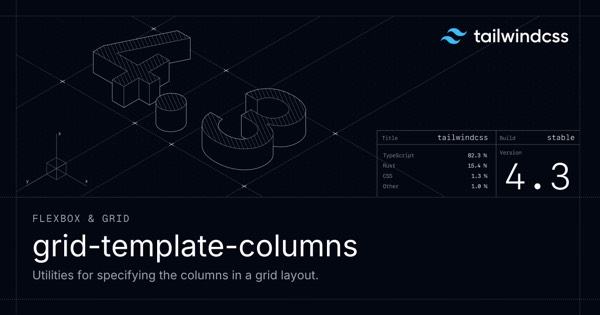</a>

### Stripe Docs

Title and description on navy with a gradient rule.

  <a href="https://docs.stripe.com/payments">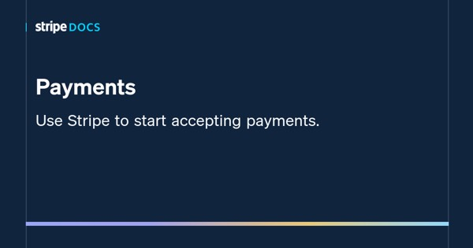</a>
  <a href="https://docs.stripe.com/webhooks">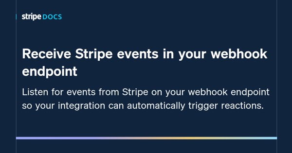</a>

### Life Itself (Flowershow)

Flowershow's own generated card: site logo and name, serif title, description, URL, orange edge.

  <a href="https://lifeitself.org/">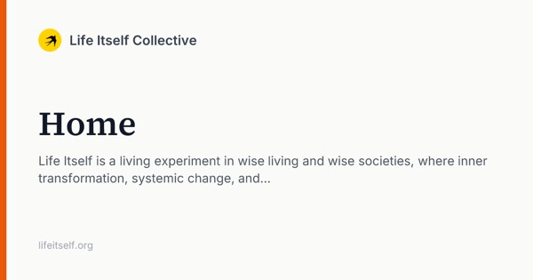</a>
  <a href="https://lifeitself.org/about">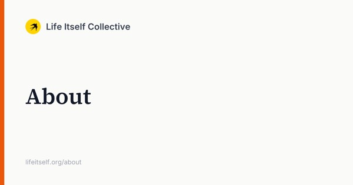</a>
  <a href="https://lifeitself.org/blog">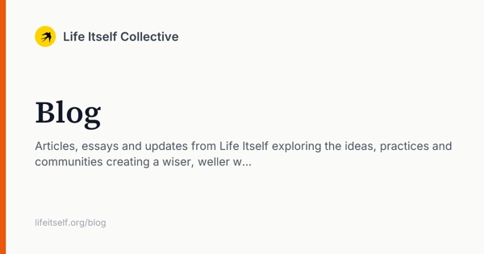</a>

### Maggie Appleton

Same idea with a personal touch: the plant illustration is fixed, the title and description change.

  
  <a href="https://maggieappleton.com/essays">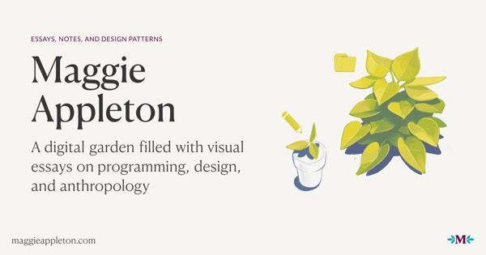</a>

## 4. Image from the page itself

Use the page's own picture: its first figure, lead image, chart or cover. Honest and varied, and free if pages have images. The weak spot is pages without one.

### Gwern

The essay's own first figure (a GPT-3 scaling plot). When there's no figure, back to the tall logo (right).

  <a href="https://gwern.net/scaling-hypothesis">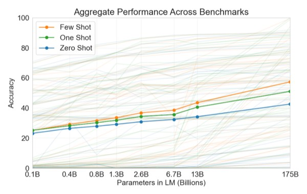</a>
  <a href="https://gwern.net/spaced-repetition">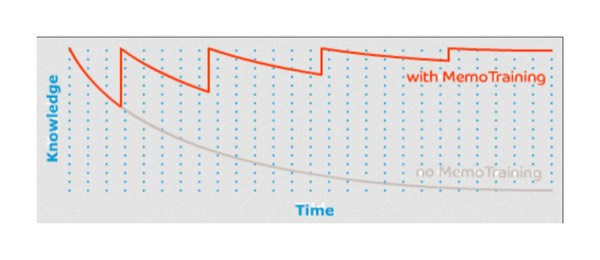</a>
  

### Wikipedia

The article's lead image. Pages without one (e.g. "Markdown") get **no image at all**.

  <a href="https://en.wikipedia.org/wiki/Open_data">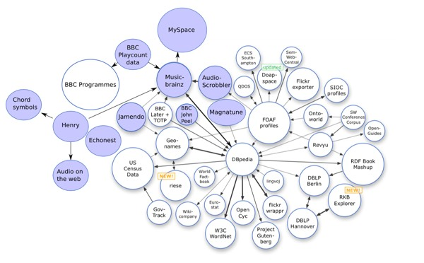</a>
  
  <a href="https://en.wikipedia.org/wiki/Wiki">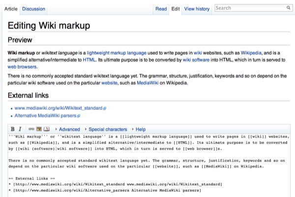</a>

### Our World in Data

The chart is the preview. Grapher pages render the chart itself as the `og:image`.

  <a href="https://ourworldindata.org/co2-emissions">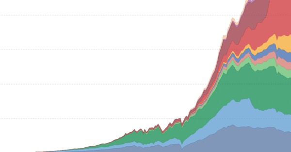</a>
  
  <a href="https://ourworldindata.org/grapher/share-of-population-in-extreme-poverty">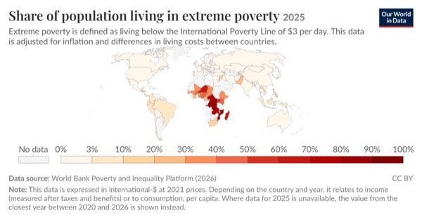</a>

### LessWrong

The post's first image or an author-set social image, cropped to 1.91:1 by Cloudinary.

  
  <a href="https://www.lesswrong.com/posts/R5g8YT25G9DXJJ48n/glm-5-3-sometimes-considers-how-train-time-actions-shape">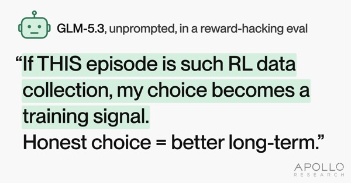</a>
  <a href="https://www.lesswrong.com/posts/oA23zoEjPnzqfHiCt/there-is-way-too-much-serendipity">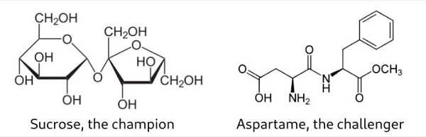</a>

### Jacky Zhao (Quartz)

A mix: hand-made cards for some posts, a photo for others.

  <a href="https://jzhao.xyz/posts/eg-strider">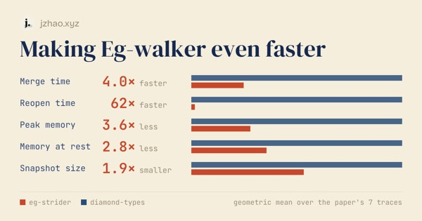</a>
  <a href="https://jzhao.xyz/posts/dappled-light">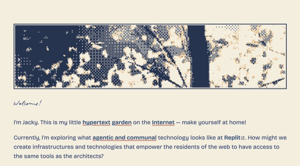</a>
  <a href="https://jzhao.xyz/posts/driving">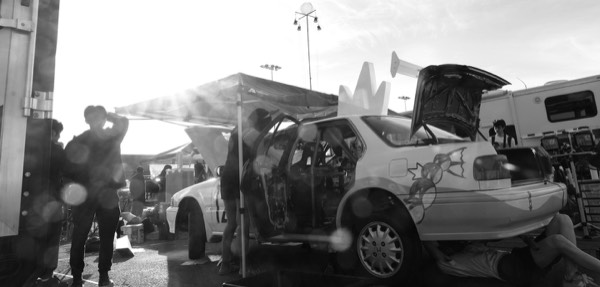</a>

### Flowershow blog

A Japanese woodblock print as the cover for each post (frontmatter `image`). Beautiful and consistent, but raw: no title on the card.

  
  
  

## Combining them: a fallback chain

Use hand-made art when a page has it and a generated card when it doesn't. Every page looks deliberate.

### Linear

Hub pages get the generated `/api/og/generic?title=…` card (left); essays get their own art (middle, right).

  
  <a href="https://linear.app/now/five-principles-working-with-loops">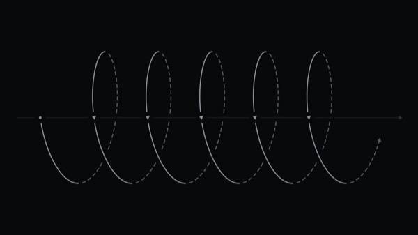</a>
  

### Substack (Lenny's Newsletter)

The post's image, cropped to 1200×675. I didn't check what a post with no image gets.

  <a href="https://www.lennysnewsletter.com/p/how-to-tell-if-a-startup-has-a-moat">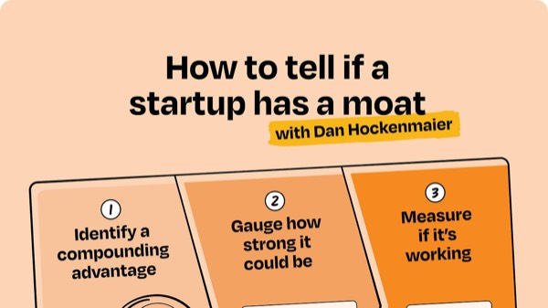</a>
  <a href="https://www.lennysnewsletter.com/p/all-of-the-lenny-and-friends-summit">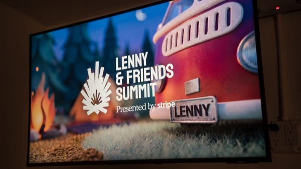</a>
  

## What this means for Flowershow-like sites

Flowershow sites are mostly blogs, wikis and knowledge bases written in Markdown, so most pages have no picture. What they need:

1. **A generated card for every page by default** (strategy 3). Title, description (frontmatter, else a cleaned first sentence: Obsidian's card shows a run-on dump of page text, so leave it out rather than do that), site name and logo, and the **section or folder** ("Notes", "Blog", "Docs › Config"). The section is cheap and is what makes wiki previews look varied (Next.js, Mintlify, Tailwind).
2. **The page's featured image when it has one** (frontmatter `image`). Two ways to show it:
   - **Raw**, like the Flowershow blog's woodblock prints, Every and Substack. Best when the image is already a designed card or strong art. Crop it to 1.91:1 around the centre: the woodblock covers are 3:2 and get cut at the edges.
   - **Composed into the card**: picture on one side, title on the other, like Luma, Cloudflare and Vercel. The site stays recognisable and the title still shows. Probably the better default for a mixed site.
3. **Optional: the first image in the page** (Gwern, LessWrong). Off by default, since a random screenshot can make a worse card than text.
4. **Site image only for the home page**, and as a last resort. A site-wide image on every page is the MDN failure.
5. **The card should look like the site**: its fonts, colours and logo, not a generic template. Astro, Tailwind, Stripe and Obsidian cards are each instantly recognisable.

### Where Flowershow is today

I checked the Flowershow code: `resolveSocialImage` in `apps/flowershow/lib/social-preview.ts` (origin/main, 2026-10-26). The generated card is `/_og/…`, rendered with Satori from `components/og/social-card.tsx`. With social cards on, a page's preview is:

| Site | Page has `image` | No page image, site has `image` | Neither |
|---|---|---|---|
| Free | generated card (page image **ignored**) | generated card | generated card |
| Premium | page image, raw | **site image, on every such page** | generated card |
| Password-protected | site-level card | site-level card | site-level card |

- Good: the generated card exists and works (see Life Itself above). It shows logo, title, description and URL.
- **Gap 1 (premium):** a site-wide `image` beats the per-page card. Set one, and every page without its own image shows the same picture, the MDN failure. Fix: page image → generated card, with the site image only for `/`.
- **Gap 2 (free):** the opposite problem. A page's featured image never shows. Whether to allow it is a product call, but the featured image is the best preview a page has.
- **Gap 3:** a page `image` is used raw and uncropped. There's no composed option with the title on it.
- **Gap 4:** the card has a fixed look (orange edge, Source Serif and Inter) rather than the site's theme, and no section or breadcrumb line.
