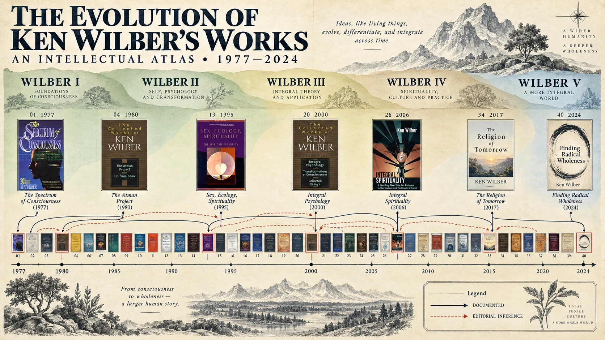
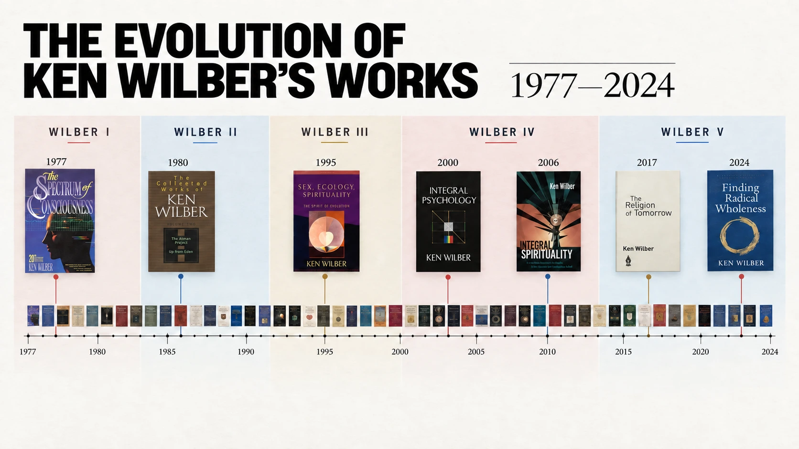
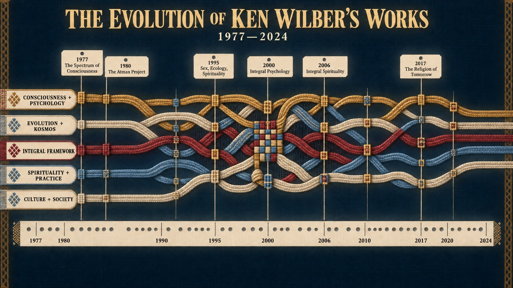
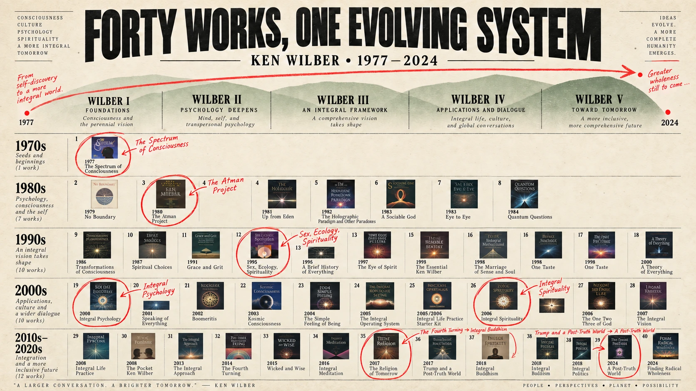
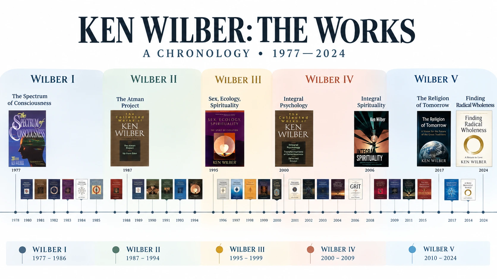

# Wilber works visualization — exploratory comps

Early visual-direction studies for a proposed visualization of Ken Wilber's works,
created for [Wilber Wiki](https://wilber.wiki) in September 2026.

These are archived as design exploration, not approved directions. They were rejected
because the visual styling preceded a sufficiently clear analytical job and sourced
concept-lineage dataset. The subsequent project direction is to research when key
concepts emerge, develop, and become integrated before choosing between a top-down
concept-stream map, a book-by-concept score, or a focused genealogy.

## Comps

### Evolutionary Atlas

### The Exhibition Wall

### Thought Woven

### Forty Works, One Field

### Polished Timeline

## Supporting material

- [`directions.json`](./directions.json) preserves the original design-direction
  descriptions, palettes, arguments, and risks.
- [`project-brief.md`](./project-brief.md) preserves the product context used to
  generate the exploration.
- `source-state/` preserves the small Impeccable decision-session record.

Source project: <https://github.com/life-itself/wilber-wiki>. The current research and
design plan lives there under
`docs/plans/2026-09-17-wilber-works-visualization-research-and-design.md`.
